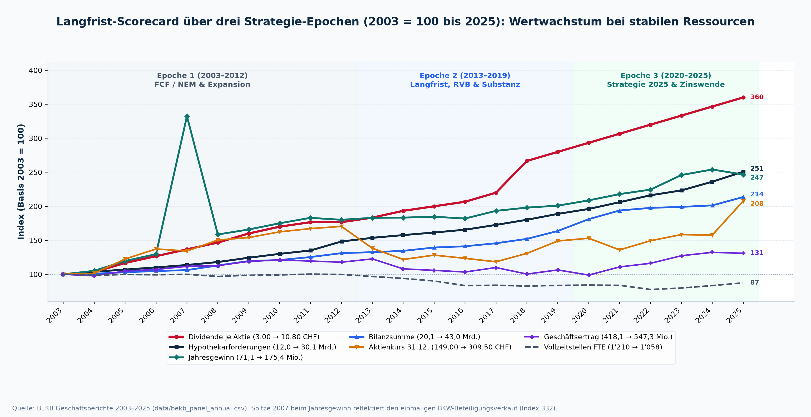

# BEKB Geschäftsberichte Analysen (2003–2026)

[](https://github.com/chatelao/bekb-geschaeftsbereichte-analysen/actions/workflows/docs-cicd.yml)
-0F2942)


Strukturierte, vollständig reproduzierbare Längsschnitt-, Bilanz-, Risiko- und Governance-Analyse der **Berner Kantonalbank AG (BEKB)** über **24 Berichtsjahre** (`2003` bis `H1 / 06-2026`). Alle **57 Originalberichte** (23 Geschäftsberichte, 14 Semesterberichte und 20 Offenlegungsberichte) werden über eine vierstufige **«Hydrogen-First» Map-Validate-Reduce-Pipeline** extrahiert, deterministisch kreuzvalidiert und in **7 Mehrjahresberichte** sowie **13 hochauflösende Visualisierungen** überführt.



---

## Inhaltsverzeichnis

- [Kernaussagen & Eckwerte (2003–2026)](#kernaussagen-eckwerte-20032026)
- [Berichtskatalog (7 Mehrjahresanalysen & 13 Grafiken)](#berichtskatalog-7-mehrjahresanalysen-13-grafiken)
- [Datenqualität, Methodik & Pipeline](#datenqualitat-methodik-pipeline)
- [Validierte Datensätze & Repository-Struktur](#validierte-datensatze-repository-struktur)
- [Reproduzierbarkeit & Read the Docs CI/CD](#reproduzierbarkeit-read-the-docs-cicd)

---

## Kernaussagen & Eckwerte (2003–2026)

| Kennzahl | 2003 | 2015 | 2025 | H1 / 06-2026 | Langfrist-Trend |
| :--- | :---: | :---: | :---: | :---: | :--- |
| **Bilanzsumme** (Mio. CHF) | 20'117,0 | 28'034,7 | **42'977,0** | **44'654,9** | Mehr als verdoppelt (+122 % bis 06-2026) |
| **Hypothekarforderungen** (Mio. CHF) | 12'004,0 | 19'377,5 | **30'099,6** | **31'057,1** | Kernwachstum (69,6 % der Bilanzsumme) |
| **Kundeneinlagen** (Mio. CHF) | 13'709,7 | 22'082,9 | **28'086,7** | **28'754,4** | 87,7 % Deckungsgrad der Ausleihungen |
| **Geschäftsertrag** (Mio. CHF) | 418,1 | 442,2 | **547,3** | 291,2 *(H1)* | Kommissionsanteil auf 23,0 % ausgebaut |
| **Jahres- / Halbjahresgewinn** (Mio. CHF) | 71,1 | 131,3 | **175,4** | 82,6 *(H1)* | +146,7 % nominal (+119 % real 2025) |
| **Cost-Income-Ratio (CIR)** | 50,4 % | 57,4 % *(ber.)* | **51,3 %** | **49,1 %** | Hohe Kostendisziplin über alle Zinszyklen |
| **Ordentliche Dividende / Aktie** | CHF 3.00 | CHF 6.00 | **CHF 10.80** | – | 30. ordentliche Erhöhung in Folge |
| **CET1- / Gesamtkapitalquote** | – | 19,47 / 19,61 % | 18,28 / 20,39 % | **18,04 / 20,08 %** | Weit über FINMA-Zielgrössen (9,26 / 13,46 %) |

### Inflationsbereinigter Gewinn- vs. Vergütungsvergleich (real 2025 CHF)

Rückwirkend auf Kaufkraft 2025 bereinigt (**BFS LIK**, `Dez. 1982 = 100`, Faktor `1,116` für 2004 bzw. `1,059` für 2008):

- **Gesamtgewinn (real 2025):** stieg von **83,5 Mio. CHF (2004)** bzw. **119,3 Mio. CHF (2008)** auf **175,4 Mio. CHF (2025)** (`+110,1 %` seit 2004 / `+46,9 %` seit 2008) und übersteigt seit 2018/2019 dauerhaft die gesamten ordentlichen Lohnkosten.
- **Personalaufwand je FTE (real 2025):** erhöhte sich von **125,9 TCHF (2004)** auf **145,4 TCHF (2025, +15,5 %)**, während die gesamten realen Lohnkosten durch den Stellenrückgang (`1'193` → `1'058 FTE`) mit **150,2 → 153,8 Mio. CHF (+2,4 %)** nahezu stabil blieben.
- **Spitzenvergütungen (real 2025):** Durch den Verzicht auf variable VR-Vergütungen (ab 2017) und zurückhaltende Anpassungen sanken im Vergleich 2004 → 2025 der **Ø VR-Sitz (–17,0 %, 194 → 161 TCHF)**, die **Ø GL-Vergütung ohne CEO (–8,4 %, 719 → 658 TCHF)** und der **CEO-Lohn (–4,7 %, 1'047 → 998 TCHF)**.

---

## Berichtskatalog (7 Mehrjahresanalysen & 13 Grafiken)

Eine vollständige Übersicht mit Eckdaten liegt auch in [`reports/README.md`](./reports/README.md).

| Nr. | Mehrjahresbericht | Zentrale Fragestellungen & Visualisierungen |
| :---: | :--- | :--- |
| **01** | [Zinszyklen & Ertragsarchitektur (2003–2025)](./reports/01_zinszyklen_und_ertragsarchitektur_2003_2025.md) | Zinsmarge vs. Volumenwachstum, Kommissionsdiversifikation; **Wasserfalldiagramm FY2025** & **Ertrag/Kosten/Marge-Kombichart** |
| **02** | [Bilanzwachstum, Hypotheken & Refinanzierung (2003–2026)](./reports/02_bilanzwachstum_hypotheken_und_refinanzierung_2003_2026.md) | Verdopplung der Bilanz auf 44,65 Mrd. CHF; **Gestapelte Bilanzsäulen (absolut & 100 %)**, **Treemap**, **Sankey-Diagramm (Goldene Bilanzregel)** & **Langfristwachstum** |
| **03** | [Aufsichtsrechtliche Resilienz & Basel III (2015–2026)](./reports/03_aufsichtsrechtliche_resilienz_basel_iii_2015_2026.md) | Alle 20 Offenlegungsberichte inkl. *Basel III final* ab 2025; **Horizontaler Soll-Ist-Vergleich** & **Basel-III-Zeitreihe** |
| **04** | [Operative Effizienz & Transformation (2003–2025)](./reports/04_operative_effizienz_und_transformation_2003_2025.md) | FTE-Produktivität, IT-/Sachaufwand, Filialwandel; **Effizienz-/CIR-Chart** & **Reale Lohn- vs. Gewinnentwicklung** |
| **05** | [BEKB-Aktie, Dividende & Kanton Bern (2003–2025)](./reports/05_aktie_dividenden_und_wertschoepfung_2003_2025.md) | 30 Dividendenerhöhungen in Folge, **1'607,4 Mio. CHF** an die öffentliche Hand; **Kurs-/Dividendenchart** |
| **06** | [Unterjährige Dynamik (Semesterberichte 2013–2026)](./reports/06_unterjaehrige_dynamik_semesterberichte_2013_2026.md) | H1-Saisonalität (~49,7 % des FY-Ertrags) & antizyklische Reservensteuerung; **H1/H2-Reservenchart** |
| **07** | [Strategische Epochen & Governance (2003–2026)](./reports/07_strategische_epochen_und_governance_2003_2026.md) | Epochen 2003–2012 / 2013–2019 / 2020–2026; **Langfrist-Scorecard (2003 = 100)** & **Inflationsbereinigter Vergütungsvergleich (real 2025 CHF)** |

---

## Datenqualität, Methodik & Pipeline

Die vollständige technische Spezifikation findet sich in [`ANALYSE_STRATEGIE.md`](./ANALYSE_STRATEGIE.md), das Audit-Protokoll in [`data/validation_report.md`](./data/validation_report.md).

```text
  57 PDFs (pdf/) ──▶ 57 Markdown (.md/) ──▶ Stufe 1: Python Chunker (data/chunks/)
                                                  │
  7 Berichte & 13 Charts (reports/) ◀── Stufe 3/4: Validator, KPI-Engine & Reduce
                                                  ▲
                                            Stufe 2: Strukturierte Extraktion (data/extracted/)
```

### Abgefangene historische Strukturbrüche
1. **Sprach- und Kurzberichte (`2003–2007`):** Französischer Abschluss `2005`, englischer Kurzbericht `2006` sowie Kurzfassungen `2003`/`2007` werden über **Vorjahres-Kreuzvalidierung** (**52 automatisch geheilte Datenpunkte**) aus den Folgejahren lückenlos ergänzt.
2. **FINMA-RVB (`2015`):** Einführung des *Geschäftserfolgs* (statt *Bruttogewinn*), Umgliederung der Reserven für allgemeine Bankrisiken ins Eigenkapital und Bereinigung der einmaligen Pensionskassen-Sanierungseinlage (**83,8 Mio. CHF** in 2015 bzw. **15,3 Mio. CHF** in 2013).
3. **Einmalige Beteiligungs- und Vergütungseffekte:** Isoliert dokumentiert für BKW-Verkäufe (`2006/2007`), 10-Jahres-Nachhaltigkeitsprämie (`2012`) sowie Pensionierungsabgeltungen (`2017`).
4. **Basel III final (`ab 01.01.2025`):** Durchgängige Verfolgung von RWA-Dichte, CET1-Quote, Leverage Ratio, LCR und NSFR über 20 Stichtage (`2015` bis `06-2026`).

---

## Validierte Datensätze & Repository-Struktur

| Pfad | Beschreibung | Umfang |
| :--- | :--- | :--- |
| [`data/bekb_panel_2003_2026.csv`](./data/bekb_panel_2003_2026.csv) | Kombiniertes Gesamtpanel über alle Berichtsarten | 57 Zeilen |
| [`data/bekb_panel_annual.csv`](./data/bekb_panel_annual.csv) | Bereinigtes Jahrespanel inkl. Quoten, FTE- & Kantonskennzahlen | 23 Jahre (`2003–2025`) |
| [`data/bekb_panel_semester.csv`](./data/bekb_panel_semester.csv) | Halbjahrespanel inkl. H1/FY-Saisonalität & H2-Reservenableitung | 14 Semester (`2013–2026`) |
| [`data/bekb_panel_offenlegung.csv`](./data/bekb_panel_offenlegung.csv) | Aufsichtsrechtliches Kapital-, RWA- & Liquiditätspanel | 20 Stichtage (`2015–06-2026`) |
| [`data/bekb_verguetung_real_2003_2025.csv`](./data/bekb_verguetung_real_2003_2025.csv) | Gewinn, Lohnkosten, VR-, CEO-, GL- & FTE-Vergütung real in CHF 2025 (BFS LIK) | 23 Jahre (`2003–2025`) |
| [`data/bekb_panel_all.json`](./data/bekb_panel_all.json) | Vollständiges JSON-Dataset inkl. Validierungs-Log | Alle Dimensionen |
| [`scripts/`](./scripts/build_dataset_and_reports.py) | `chunk_reports.py`, `extract_with_hydrogen.py`, `build_dataset_and_reports.py`, `generate_charts.py`, `prepare_docs.py` | 5 Pipeline-Skripte |
| [`download_reports.py`](./download_reports.py) & [`convert_pdf_to_md.py`](./convert_pdf_to_md.py) | PDF-Download und Konvertierung nach `.md/` (siehe [`ROADMAP.md`](./ROADMAP.md)) | Vorverarbeitung |

---

## Reproduzierbarkeit & Read the Docs CI/CD

### Lokal ausführen

```bash
# 1. Validierte Datensätze (CSV/JSON) und die 7 Mehrjahresberichte neu erzeugen
python3 scripts/build_dataset_and_reports.py --backend local

# 2. Alle 13 Visualisierungen unter reports/charts/ neu rendern
uv run --with matplotlib python3 scripts/generate_charts.py

# 3. Read the Docs / MkDocs-Site lokal vorbereiten und mit Live-Reload testen
python3 scripts/prepare_docs.py
uvx --with mkdocs-material --with pymdown-extensions mkdocs serve
```

Optional kann Stufe 4 auch über die Gemini Hydrogen API ausgeführt werden (`export GEMINI_API_KEY=... && python3 scripts/build_dataset_and_reports.py --backend gemini`).

### Automatische Publikation auf Read the Docs

Dieses Repository enthält eine einsatzbereite Konfiguration für **Read the Docs** sowie **GitHub Actions**:

- **[`.readthedocs.yaml`](./.readthedocs.yaml) & [`mkdocs.yml`](./mkdocs.yml):** Nutzt `ubuntu-24.04` mit Python 3.12, bereitet über `scripts/prepare_docs.py` das optimierte Material-for-MkDocs-Layout inkl. Tabellen-Styling, Mermaid-Diagrammen, MathJax und Grafik-Galerie auf und prüft mit `fail_on_warning: true`.
- **[`.github/workflows/docs-cicd.yml`](./.github/workflows/docs-cicd.yml):**
  1. Verifiziert bei jedem Push/PR auf `main`, dass `scripts/build_dataset_and_reports.py --backend local` reproduzierbar bleibt und `data/` bzw. `reports/` aktuell sind.
  2. Baut die Dokumentation strikt mit `mkdocs build --strict` und legt die fertige Seite als Build-Artefakt ab.
  3. Löst bei Push auf `main` optional einen Read-the-Docs-Webhook aus (sofern in den GitHub Repository Secrets `RTD_WEBHOOK_URL` und `RTD_WEBHOOK_TOKEN` hinterlegt sind; bei verknüpfter GitHub-App baut Read the Docs zusätzlich automatisch).
