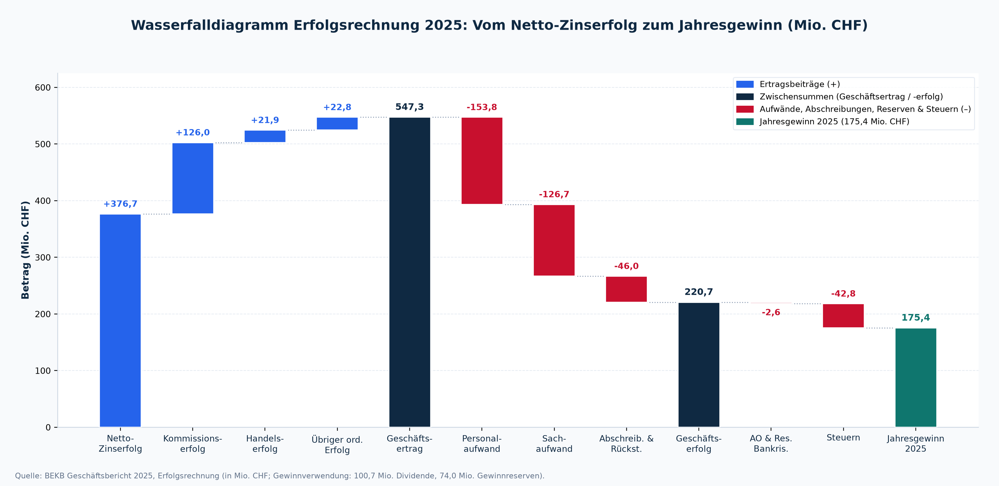
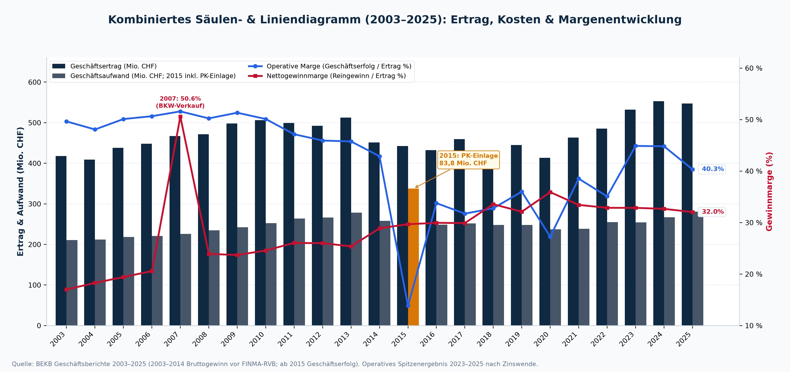

# Mehrjahresbericht 1: Zinszyklen & Ertragsarchitektur im Wandel (2003–2025)

> **Datenbasis:** Bereinigte Jahresabschlüsse 2003–2025 (`data/bekb_panel_annual.csv`) sowie Ausblick H1-2026 (`data/bekb_panel_semester.csv`).

## 1. Management Summary

- **Langfristige Ertragsresilienz trotz Zinskompression:** Der Geschäftsertrag wuchs von **418,1 Mio. CHF (2003)** auf ein Allzeithoch von **553,1 Mio. CHF (2024)** und behauptete sich **2025 bei 547,3 Mio. CHF** (+30,9 %).
- **Zinsmarge vs. Volumeneffekt:** In der SNB-Negativzins-Ära (2015–2022) sank die Netto-Zinsmarge bezogen auf die Bilanzsumme von Ø **135,1 bps** (2003–2014) auf das Tief von **73,8 bps (2020)**; dank Hypothekarwachstum blieb der Netto-Zinserfolg dennoch bei durchschnittlich **292,9 Mio. CHF**.
- **Struktureller Ausbau des Kommissionsgeschäfts:** Der Erfolg aus dem Kommissions- und Dienstleistungsgeschäft stieg über 22 Jahre um **3,0 % p. a.** (2003: **66,0 Mio. CHF** $\rightarrow$ 2025: **126,0 Mio. CHF**) – deutlich schneller als der Netto-Zinserfolg (+1,2 % p. a.).
- **Zinswende 2023–2025 und Normalisierung:** Das Ende der Negativzinsen liess den Netto-Zinserfolg 2023 um +19,3 % auf **376,4 Mio. CHF** und 2024 auf den Höchstwert von **392,4 Mio. CHF** steigen; 2025 normalisierte sich das Zinsergebnis auf **376,7 Mio. CHF** (–4,0 %), während der Kommissionserfolg um +9,5 % auf den Rekordwert von **126,0 Mio. CHF** anzog.
- **Konstante Gewinnentwicklung:** Der ausgewiesene Jahresgewinn kletterte (unter Ausklammerung des BKW-Einmaleffekts **2007: 236,3 Mio. CHF**) von **71,1 Mio. CHF (2003)** auf **180,7 Mio. CHF (2024)** bzw. **175,4 Mio. CHF (2025)**.

## 2. Quantitative Entwicklung & Visuelle Analyse

### Erfolgsrechnung 2025 (Wasserfalldiagramm / Bridge Chart) & Langfristiger Ertrags-/Margentrend

### Phasenvergleich

| Phase | Ø Netto-Zinserfolg (Mio.) | Ø Kommissionserfolg (Mio.) | Ø Geschäftsertrag (Mio.) | Ø Zinsanteil (%) | Ø Kommissionsanteil (%) | Ø Zinsmarge / BS (bps) |
| :--- | :---: | :---: | :---: | :---: | :---: | :---: |
| Phase 1: Klassisches Zinsumfeld & Finanzkrise (2003–2014) | 314,2 | 86,0 | 467,6 | 67,1 % | 18,4 % | 135,1 |
| Phase 2: SNB-Negativzins-Ära (2015–2022) | 292,9 | 105,1 | 445,1 | 65,8 % | 23,6 % | 90,1 |
| Phase 3: Zinswende & Normalisierung (2023–2025) | 381,8 | 115,3 | 544,2 | 70,2 % | 21,2 % | 92,8 |

### Vollständige Jahreszeitreihe (2003–2025)

| Jahr | Netto-Zinserfolg (Mio.) | Kommissionserfolg (Mio.) | Handelserfolg (Mio.) | Geschäftsertrag (Mio.) | Geschäftserfolg (Mio.) | Jahresgewinn (Mio.) | Zinsanteil (%) | Kommissionsanteil (%) | Zinsmarge / BS (bps) |
| :---: | :---: | :---: | :---: | :---: | :---: | :---: | :---: | :---: | :---: |
| 2003 | 292,8 | 66,0 | 21,7 | 418,1 | 207,5 | 71,1 | 70,0 % | 15,8 % | 145,6 |
| 2004 | 268,7 | 76,8 | 19,8 | 408,7 | 196,5 | 74,7 | 65,7 % | 18,8 % | 132,5 |
| 2005 | 273,2 | 85,7 | 22,6 | 437,9 | 219,4 | 85,0 | 62,4 % | 19,6 % | 131,8 |
| 2006 | 278,8 | 98,1 | 22,6 | 447,9 | 226,9 | 92,2 | 62,2 % | 21,9 % | 132,3 |
| 2007 | 298,3 | 104,9 | 27,6 | 467,2 | 241,0 | 236,3 | 63,8 % | 22,4 % | 139,6 |
| 2008 | 314,7 | 93,7 | 37,8 | 471,3 | 236,7 | 112,7 | 66,8 % | 19,9 % | 138,4 |
| 2009 | 348,5 | 85,4 | 25,4 | 497,8 | 255,5 | 118,0 | 70,0 % | 17,2 % | 145,0 |
| 2010 | 358,2 | 89,8 | 22,7 | 506,4 | 253,7 | 124,4 | 70,7 % | 17,7 % | 147,2 |
| 2011 | 354,7 | 84,0 | 27,2 | 499,5 | 235,5 | 130,1 | 71,0 % | 16,8 % | 140,6 |
| 2012 | 348,5 | 78,6 | 21,9 | 492,6 | 226,2 | 128,1 | 70,8 % | 16,0 % | 132,2 |
| 2013 | 329,7 | 83,8 | 21,2 | 512,7 | 234,6 | 130,1 | 64,3 % | 16,4 % | 123,7 |
| 2014 | 304,5 | 85,0 | 21,9 | 451,4 | 193,6 | 130,4 | 67,5 % | 18,8 % | 112,5 |
| 2015 | 293,7 | 98,9 | 21,3 | 442,2 | 61,3 | 131,3 | 66,4 % | 22,4 % | 104,8 |
| 2016 | 291,4 | 100,3 | 19,3 | 432,2 | 146,0 | 129,4 | 67,4 % | 23,2 % | 102,6 |
| 2017 | 308,3 | 105,1 | 21,8 | 459,6 | 145,8 | 137,4 | 67,1 % | 22,9 % | 105,2 |
| 2018 | 273,3 | 104,7 | 20,8 | 419,5 | 137,5 | 140,8 | 65,2 % | 25,0 % | 89,4 |
| 2019 | 288,1 | 105,2 | 24,0 | 445,0 | 160,2 | 142,9 | 64,7 % | 23,6 % | 87,5 |
| 2020 | 268,7 | 105,1 | 20,9 | 413,2 | 112,7 | 148,4 | 65,0 % | 25,4 % | 73,8 |
| 2021 | 303,9 | 112,3 | 24,9 | 463,5 | 178,6 | 154,9 | 65,6 % | 24,2 % | 77,9 |
| 2022 | 315,4 | 108,9 | 37,5 | 485,7 | 170,4 | 159,6 | 64,9 % | 22,4 % | 79,3 |
| 2023 | 376,4 | 104,9 | 24,3 | 532,3 | 238,9 | 174,9 | 70,7 % | 19,7 % | 94,0 |
| 2024 | 392,4 | 115,1 | 25,0 | 553,1 | 247,9 | 180,7 | 70,9 % | 20,8 % | 96,9 |
| 2025 | 376,7 | 126,0 | 21,9 | 547,3 | 220,7 | 175,4 | 68,8 % | 23,0 % | 87,6 |

## 3. Treiberanalyse & Strukturelle Wendepunkte

1. **Finanzkrise & Tiefzinsübergang (2003–2014):** Nach dem Rückgang des Zinserfolgs 2004 (**268,7 Mio. CHF**) profitierte die BEKB zwischen 2007 und 2010 von stark wachsenden Bilanzvolumina und steileren Zinskurven; der Netto-Zinserfolg erreichte **2010: 358,2 Mio. CHF** (Zinsanteil **70,7 %**). Bemerkenswert ist der Ausreisser **2007** beim Jahresgewinn (**236,3 Mio. CHF** vs. 103,8 Mio. CHF operativ nach Steuern), ausgelöst durch den ausserordentlichen BKW-Beteiligungsverkauf (+132,5 Mio. CHF nach Steuern).
2. **Rechnungslegungswechsel FINMA-RVB & Negativzinsen (2015–2022):** Mit der Einführung von **FINMA-RVB per 2015** wurden der *Geschäftserfolg* als operative Steuerungskennzahl eingeführt sowie Zins- und Kommissionserträge neu abgegrenzt (2014 ursprünglich **85,0 Mio. CHF** Kommissionserfolg vs. restated **102,8 Mio. CHF**; Zins-Brutto vs. Wertberichtigungen). Im SNB-Negativzinsregime verteidigte die BEKB den Zinserfolg über aktive Refinanzierung und Bilanzexpansion (2015–2022 zwischen **268,7 Mio. CHF** in 2020 und **315,4 Mio. CHF** in 2022), wobei sich die Zinsmarge auf die Bilanzsumme bis 2021/2022 auf **77,9–79,3 bps** halbierte. Gleichzeitig trug das Kommissions- und Dienstleistungsgeschäft (Anlagefonds, Vermögensverwaltungsmandate) zunehmend stabil rund **22–25 %** zum Geschäftsertrag bei.
3. **Zinswende-Schub & Ertragsdiversifikation (2023–2025):** Die SNB-Leitzinserhöhungen 2022/2023 schlugen 2023/2024 direkt auf die Passiv- und Aktivmarge durch (Zinsanteil wieder über **70 %**: 2023 **70,7 %**, 2024 **70,9 %**). Als die SNB ab 2024 die Zinsen wieder senkte, federte 2025 ein starker Anstieg im Kommissionsgeschäft (**126,0 Mio. CHF**, Anteil **23,0 %**) den leichten Rückgang im Zinsgeschäft (**376,7 Mio. CHF**, Anteil **68,8 %**) weitgehend ab.

## 4. Fazit & Ausblick

Die Ertragsarchitektur der BEKB verbindet eine regional verankerte Zinsbasis mit einem kontinuierlich ausgebauten Anlage- und Kommissionsstandbein. Die ersten Halbjahreszahlen **H1-2026** bestätigen diesen Pfad: Bei einem Netto-Zinserfolg von **183,3 Mio. CHF** (–4,2 % ggü. H1-2025) stieg der Kommissionserfolg auf **70,1 Mio. CHF** (+11,9 %) und der Geschäftsertrag erreichte **291,2 Mio. CHF** (+5,1 % ggü. Vorjahr). Damit ist die BEKB im abflachenden Zinsumfeld 2026 operativ breiter abgestützt als zu Beginn der Negativzinsphase 2015.
