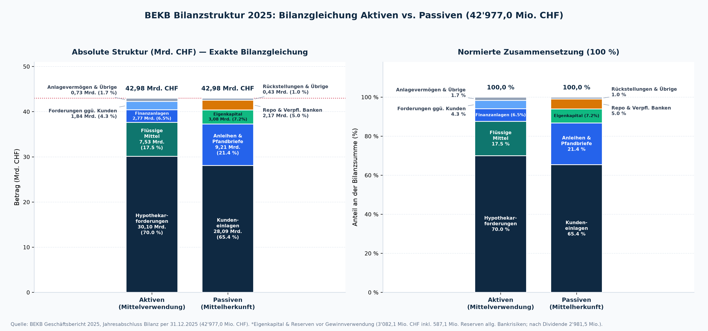
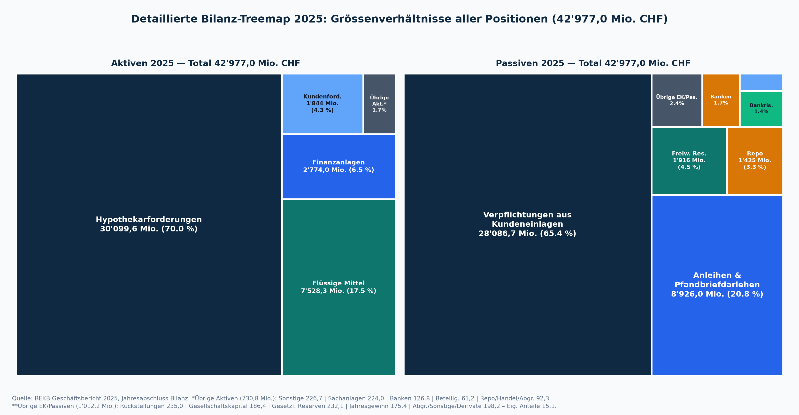
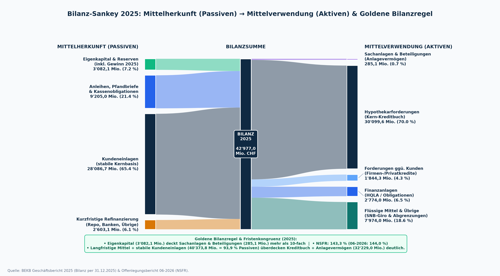
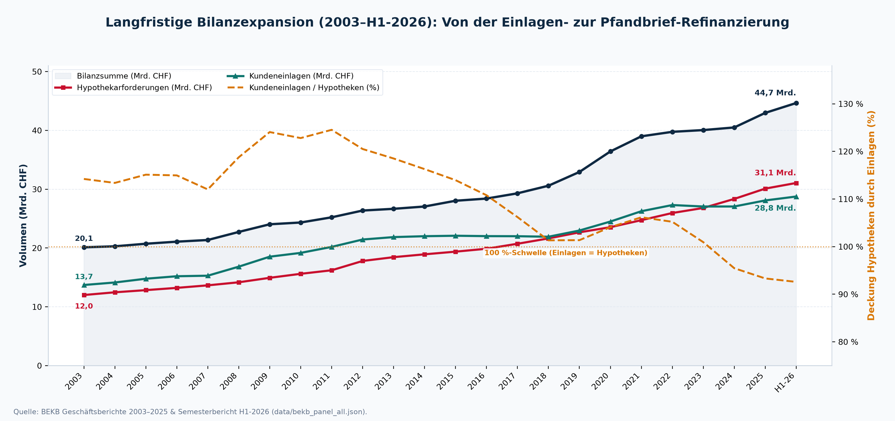

# Mehrjahresbericht 2: Bilanzwachstum, Hypothekarmarkt & Refinanzierungskraft (2003–2026)

> **Datenbasis:** Bereinigte Jahresabschlüsse 2003–2025 (`data/bekb_panel_annual.csv`) und aktueller Semesterabschluss per 30.06.2026 (`data/bekb_panel_semester.csv`).

## 1. Management Summary

- **Verdopplung der Bilanzsumme:** Zwischen 2003 (**20'117,0 Mio. CHF**) und **H1-2026 (44'654,9 Mio. CHF)** hat sich die Bilanzsumme der BEKB mehr als verdoppelt (+122,0 %; CAGR 2003–2025: **+3,5 %**).
- **Hypothekarkern als Wachstumsmotor:** Das Hypothekarvolumen stieg von **12'004,0 Mio. CHF (2003)** auf **30'099,6 Mio. CHF (2025)** bzw. **31'057,1 Mio. CHF (30.06.2026)** (CAGR 2003–2025: **+4,3 %**). Der Anteil an der Bilanzsumme kletterte von **59,7 % (2003)** bis auf **70,5 % (2017–2018)** und liegt aktuell bei **69,6 % (H1-2026)**.
- **Starke Refinanzierung durch Kundeneinlagen:** Die Kundeneinlagen wuchsen von **13'709,7 Mio. CHF (2003)** auf **28'086,7 Mio. CHF (2025)** bzw. **28'754,4 Mio. CHF (H1-2026)** (CAGR: **+3,3 %**). Bis **2013** deckten Kundeneinlagen sogar weit über 100 % der Hypothekarforderungen (Spitze **2011: 124,5 %**); heute liegt die Deckung der gesamten Kundenausleihungen (inkl. übriger Kundenforderungen) stabil bei **87,7 % (H1-2026)** bzw. **87,9 % (2025)**.
- **Substanzaufbau über Bankrisikoreserven & Eigenkapital:** Das ausgewiesene Eigenkapital stieg (unter Berücksichtigung der FINMA-RVB-Umstellung 2015) auf **2'981,0 Mio. CHF (2025)**; allein die Reserven für allgemeine Bankrisiken wurden bis **H1-2026 auf 608,0 Mio. CHF** ausgebaut.

## 2. Bilanzstruktur & Visuelle Analyse

### Bilanzgleichung 2025: Gestapeltes Säulendiagramm (Absolut & 100 %)

### Detaillierte Bilanz-Treemap 2025 (42'977,0 Mio. CHF)

### Mittelherkunft → Mittelverwendung & Goldene Bilanzregel (Sankey-Diagramm 2025)

### Langfristige Bilanzentwicklung 2003–H1-2026

### Quantitative Entwicklung im Phasenvergleich

| Phase | Bilanzsumme Start $\rightarrow$ Ende (Mio.) | Hypotheken Start $\rightarrow$ Ende (Mio.) | Ø Hypo-Anteil BS (%) | Ø Deckungsgrad Ausleihungen (%) |
| :--- | :---: | :---: | :---: | :---: |
| 2003–2014 (Vorkrise & Post-2008) | 20'117,0 $\rightarrow$ 27'055,0 | 12'004,0 $\rightarrow$ 18'925,5 | 64,1 % | 106,3 % |
| 2015–2022 (Negativzins-Ära) | 28'034,7 $\rightarrow$ 39'757,3 | 19'377,5 $\rightarrow$ 25'950,8 | 67,8 % | 99,1 % |
| 2023–2025 & H1-2026 (Zinswende) | 40'053,5 $\rightarrow$ 44'654,9 | 26'809,2 $\rightarrow$ 31'057,1 | 69,0 % | 90,2 % |

### Bilanz- & Refinanzierungszeitreihe (2003–H1-2026)

| Periode | Bilanzsumme (Mio.) | YoY (%) | Hypotheken (Mio.) | Hypo-Anteil BS (%) | Kundeneinlagen (Mio.) | Einlagen / Hypotheken (%) | Deckungsgrad Ausleihungen (%) | Ausgew. Eigenkapital (Mio.) |
| :---: | :---: | :---: | :---: | :---: | :---: | :---: | :---: | :---: |
| FY2003 | 20'117,0 | – | 12'004,0 | 59,7 % | 13'709,7 | 114,2 % | 102,7 % | 1'017,0 |
| FY2004 | 20'286,1 | 0,8 % | 12'465,6 | 61,5 % | 14'134,0 | 113,4 % | 111,3 % | 1'069,0 |
| FY2005 | 20'724,4 | 2,2 % | 12'835,0 | 61,9 % | 14'774,8 | 115,1 % | 106,4 % | 1'026,0 |
| FY2006 | 21'077,3 | 1,7 % | 13'219,2 | 62,7 % | 15'196,8 | 115,0 % | 105,4 % | 1'085,0 |
| FY2007 | 21'360,5 | 1,3 % | 13'649,0 | 63,9 % | 15'288,5 | 112,0 % | 102,3 % | 1'168,0 |
| FY2008 | 22'730,0 | 6,4 % | 14'168,1 | 62,3 % | 16'825,4 | 118,8 % | 105,0 % | 1'115,0 |
| FY2009 | 24'035,5 | 5,7 % | 14'930,2 | 62,1 % | 18'522,0 | 124,1 % | 111,8 % | 1'186,0 |
| FY2010 | 24'335,1 | 1,2 % | 15'609,8 | 64,2 % | 19'168,9 | 122,8 % | 106,7 % | 1'293,0 |
| FY2011 | 25'218,6 | 3,6 % | 16'211,0 | 64,3 % | 20'188,2 | 124,5 % | 109,1 % | 1'379,0 |
| FY2012 | 26'371,2 | 4,6 % | 17'794,9 | 67,5 % | 21'442,2 | 120,5 % | 106,1 % | 1'415,0 |
| FY2013 | 26'663,4 | 1,1 % | 18'440,4 | 69,2 % | 21'854,0 | 118,5 % | 106,2 % | 1'496,0 |
| FY2014 | 27'055,0 | 1,5 % | 18'925,5 | 70,0 % | 22'006,6 | 116,3 % | 102,7 % | 1'592,0 |
| FY2015 | 28'034,7 | 3,6 % | 19'377,5 | 69,1 % | 22'082,9 | 114,0 % | 106,7 % | 2'267,0 |
| FY2016 | 28'404,7 | 1,3 % | 19'873,8 | 70,0 % | 22'018,0 | 110,8 % | 102,8 % | 2'340,0 |
| FY2017 | 29'298,1 | 3,1 % | 20'719,9 | 70,7 % | 22'004,0 | 106,2 % | 98,4 % | 2'433,0 |
| FY2018 | 30'589,2 | 4,4 % | 21'628,2 | 70,7 % | 21'914,0 | 101,3 % | 92,8 % | 2'503,0 |
| FY2019 | 32'929,8 | 7,7 % | 22'663,5 | 68,8 % | 22'970,3 | 101,3 % | 95,5 % | 2'554,0 |
| FY2020 | 36'421,7 | 10,6 % | 23'537,7 | 64,6 % | 24'498,4 | 104,1 % | 98,2 % | 2'562,0 |
| FY2021 | 38'993,6 | 7,1 % | 24'730,8 | 63,4 % | 26'254,4 | 106,2 % | 100,1 % | 2'620,0 |
| FY2022 | 39'757,3 | 2,0 % | 25'950,8 | 65,3 % | 27'304,0 | 105,2 % | 98,7 % | 2'677,0 |
| FY2023 | 40'053,5 | 0,8 % | 26'809,2 | 66,9 % | 27'057,6 | 100,9 % | 94,0 % | 2'794,0 |
| FY2024 | 40'499,3 | 1,1 % | 28'346,8 | 70,0 % | 27'059,2 | 95,5 % | 88,6 % | 2'902,0 |
| FY2025 | 42'977,0 | 6,1 % | 30'099,6 | 70,0 % | 28'086,7 | 93,3 % | 87,9 % | 2'981,0 |
| **H1-2026** | **44'654,9** | – | **31'057,1** | **69,5 %** | **28'754,4** | **92,6 %** | **87,7 %** | – |

## 3. Treiberanalyse & Strukturelle Wendepunkte

1. **Hypothekarsprung 2012 & Portfoliokauf:** Im Jahr **2012** stiegen die Hypothekarforderungen um **+9,8 %** (+1'583,9 Mio. CHF) auf **17'794,9 Mio. CHF**, getrieben sowohl durch organisches KMU-/Privatkundenwachstum im Espace Mittelland als auch den gezielten Kauf eines Hypothekenportefeuilles.
2. **FINMA-RVB 2015 – Eigenkapital-Neuzuordnung:** Der scheinbare Sprung beim ausgewiesenen Eigenkapital von **1'592,0 Mio. CHF (2014)** auf **2'267,0 Mio. CHF (2015)** ist ein rechnerischer Effekt der **FINMA-RVB-Umstellung** (Vorjahr 2014 angepasst: **2'246,0 Mio. CHF**), da die *Reserven für allgemeine Bankrisiken* (2015: **601,4 Mio. CHF**) neu zum Eigenkapital zählen.
3. **Pandemie-Liquiditätsschub 2020–2021:** Während COVID-19 flossen der Bank stark Kundengelder und SNB-Liquidität zu: Die Bilanzsumme sprang **2020 um +10,6 %** (auf **36'421,7 Mio. CHF**) und **2021 um +7,1 %** (auf **38'993,6 Mio. CHF**), während die Einlagen um **+6,7 %** bzw. **+7,2 %** zulegten.
4. **Refinanzierungs-Dynamik ab 2023:** Nach den Rekordjahren 2021–2022 und moderaten Einlagenbewegungen in 2023/2024 beschleunigte sich das Bilanz- und Kreditwachstum **2025 (+6,1 % Bilanzsumme, +6,2 % Hypotheken)** erneut deutlich und setzte sich im **1. Halbjahr 2026** fort (**+3,9 %** Bilanzsumme in 6 Monaten). Dennoch bleibt der Refinanzierungsüberhang (Differenz zwischen Ausleihungen und Kundeneinlagen) dank Pfandbriefdarlehen, Kassenobligationen (**279,0 Mio. CHF** in 2025) und starker Eigenmittelbasis solide gedeckt.

## 4. Fazit & Ausblick

Per **30. Juni 2026** überschreitet die Bilanzsumme erstmals **44,6 Mrd. CHF** (**44'654,9 Mio. CHF**), bei **31'057,1 Mio. CHF** Hypothekarforderungen und **28'754,4 Mio. CHF** Kundeneinlagen. Die BEKB verbindet über den gesamten 23-Jahres-Zeitraum disziplinierte Kreditvergabe mit einem historisch hohen Selbstfinanzierungsgrad (Kundeneinlagen decken ~88 % aller Ausleihungen), was Refinanzierungsrisiken in Stressphasen eng begrenzt.
