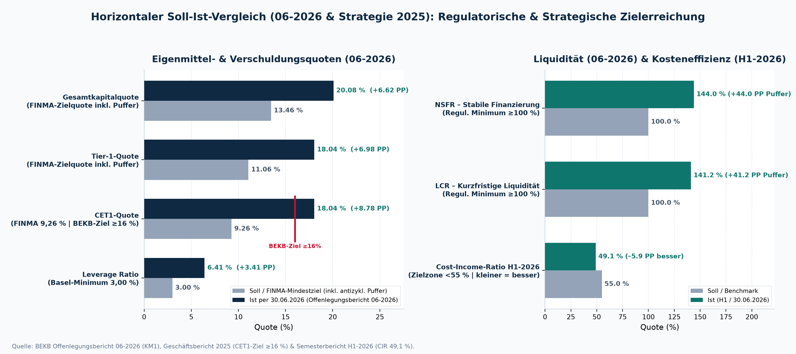
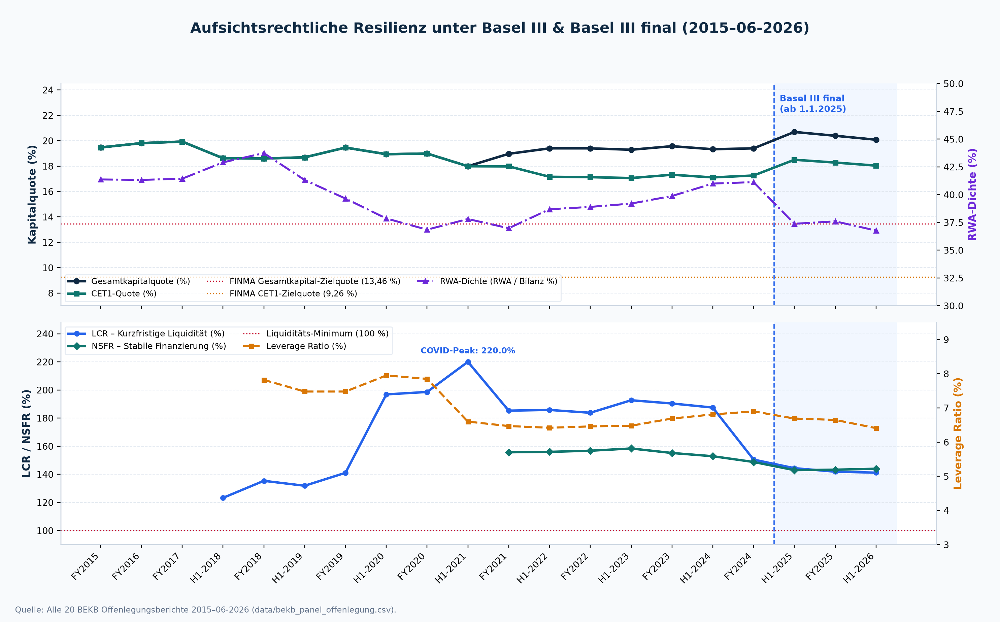

# Mehrjahresbericht 3: Aufsichtsrechtliche Resilienz & Basel-III-Evolution (2015–2026)

> **Datenbasis:** Alle 20 Offenlegungsberichte (`2015–2025` jährlich sowie `06-2018–06-2026` halbjährlich) aus `data/bekb_panel_offenlegung.csv`.

## 1. Management Summary

- **Komfortable Kapitalausstattung deutlich über FINMA-Zielgrössen:** Über alle 20 Stichtage hinweg übertraf die BEKB die regulatorischen Zielquoten für Banken der FINMA-Kategorie 3 (gemäss KM1 inkl. antizyklischem Puffer aktuell **9,26 % CET1** bzw. **13,46 % Gesamtkapitalquote**) massiv. Per **30.06.2026** liegen die **CET1-Quote bei 18,04 %** und die **Gesamtkapitalquote bei 20,08 %** (**+6,62 Prozentpunkte** Überschuss).
- **Wandel von RWA & Kapitalqualität:** Das harte Kernkapital (CET1) wuchs von **2'258,8 Mio. CHF (2015)** auf **2'962,3 Mio. CHF (H1-2026, +31,1 %)**, während sich die risikogewichteten Positionen (RWA) von **11'598,7 Mio. CHF** auf **16'421,1 Mio. CHF (+41,6 %)** erhöhten.
- **Ungefährdete Leverage Ratio:** Trotz Bilanzausweitung während COVID-19 (und nach Auslaufen der SNB-Ausnahmen) notierte die **Leverage Ratio** durchwegs weit über der Basler Mindestvorgabe von 3,0 % (Bandbreite **6,41 % in H1-2026** bis **7,95 % in H1-2020**).
- **Stresstest in der Schweizer Bankenkrise 2023 bestanden:** Im Frühjahr/Herbst 2023 (CS-Übernahme) blieben sowohl **LCR (H1-2023: 192,7 %; FY2023: 190,4 %)** als auch **NSFR (H1-2023: 158,4 %; FY2023: 155,2 %)** weit oberhalb des 100 %-Minimums.
- **Struktureffekt Basel III final (2025/2026):** Mit Einführung von Basel III final am **1. Januar 2025** sank die RWA-Dichte durch angepasste Kredit- und Operational-Risk-Gewichtungen von **41,1 % (FY2024)** auf **37,4 % (H1-2025)** bzw. **36,8 % (06-2026)**, was trotz wachsenden Kreditbuchs einen Anstieg der CET1-Quote auf **18,28 % (FY2025)** bzw. **18,04 % (06-2026)** unterstützte.

## 2. Quantitative Entwicklung & Soll-Ist-Vergleich

### Horizontaler Balkenvergleich (Soll-Ist-Controlling per 30.06.2026)

### Basel-III-Kapitalquoten, RWA-Dichte & Liquiditätskennzahlen (2015–06-2026)

### Phasenvergleich

| Aufsichtsregime | Stichtage | Ø CET1-Quote (%) | Ø Gesamtkapitalquote (%) | Ø Leverage Ratio (%) | Ø RWA-Dichte (%) | Ø LCR (%) | Ø NSFR (%) |
| :--- | :---: | :---: | :---: | :---: | :---: | :---: | :---: |
| Basel III (2015–2019) | 7 | 19,23 % | 19,23 % | 7,59 % | 41,7 % | 132,9 % | – |
| Basel III (2020–2024) | 10 | 17,69 % | 19,13 % | 6,86 % | 38,8 % | 189,1 % | 154,8 % |
| Basel III final (2025–06-2026) | 3 | 18,27 % | 20,39 % | 6,58 % | 37,2 % | 142,5 % | 143,4 % |

### Vollständige KM1-/OV1-Zeitreihe (2015–06-2026)

| Stichtag | Regime | CET1 (Mio.) | Gesamtkapital (Mio.) | RWA (Mio.) | RWA-Dichte (%) | CET1-Quote (%) | Gesamtkapitalquote (%) | Puffer über 13,46 %-Ziel (PP) | Leverage Ratio (%) | LCR (%) | NSFR (%) |
| :---: | :--- | :---: | :---: | :---: | :---: | :---: | :---: | :---: | :---: | :---: | :---: |
| FY2015 | Basel III | 2'258,8 | 2'258,8 | 11'598,7 | 41,4 % | 19,47 % | 19,47 % | 6,01 | – | – | – |
| FY2016 | Basel III | 2'326,1 | 2'326,1 | 11'739,8 | 41,3 % | 19,81 % | 19,81 % | 6,35 | – | – | – |
| FY2017 | Basel III | 2'419,6 | 2'419,6 | 12'142,4 | 41,4 % | 19,93 % | 19,93 % | 6,47 | – | – | – |
| H1-2018 | Basel III | 2'422,9 | 2'422,9 | 13'010,5 | 42,9 % | 18,62 % | 18,62 % | 5,16 | – | 123,3 % | – |
| FY2018 | Basel III | 2'489,0 | 2'489,0 | 13'379,9 | 43,7 % | 18,60 % | 18,60 % | 5,14 | 7,82 % | 135,4 % | – |
| H1-2019 | Basel III | 2'497,8 | 2'497,8 | 13'366,8 | 41,3 % | 18,69 % | 18,69 % | 5,23 | 7,48 % | 131,9 % | – |
| FY2019 | Basel III | 2'540,5 | 2'540,5 | 13'057,8 | 39,6 % | 19,46 % | 19,46 % | 6,00 | 7,48 % | 141,1 % | – |
| H1-2020 | Basel III | 2'540,0 | 2'540,0 | 13'412,4 | 37,9 % | 18,94 % | 18,94 % | 5,48 | 7,95 % | 196,9 % | – |
| FY2020 | Basel III | 2'548,4 | 2'548,4 | 13'420,3 | 36,9 % | 18,99 % | 18,99 % | 5,53 | 7,85 % | 198,6 % | – |
| H1-2021 | Basel III | 2'555,3 | 2'555,3 | 14'201,8 | 37,8 % | 17,99 % | 17,99 % | 4,53 | 6,60 % | 220,0 % | – |
| FY2021 | Basel III | 2'592,9 | 2'735,6 | 14'418,8 | 37,0 % | 17,98 % | 18,97 % | 5,51 | 6,47 % | 185,3 % | 155,7 % |
| H1-2022 | Basel III | 2'601,0 | 2'940,4 | 15'160,9 | 38,7 % | 17,16 % | 19,40 % | 5,94 | 6,42 % | 185,8 % | 156,0 % |
| FY2022 | Basel III | 2'649,8 | 3'000,2 | 15'466,6 | 38,9 % | 17,13 % | 19,40 % | 5,94 | 6,46 % | 183,8 % | 156,8 % |
| H1-2023 | Basel III | 2'670,2 | 3'019,5 | 15'653,3 | 39,2 % | 17,06 % | 19,29 % | 5,83 | 6,48 % | 192,7 % | 158,4 % |
| FY2023 | Basel III | 2'767,3 | 3'127,0 | 15'975,3 | 39,9 % | 17,32 % | 19,57 % | 6,11 | 6,69 % | 190,4 % | 155,2 % |
| H1-2024 | Basel III | 2'793,6 | 3'154,7 | 16'323,7 | 41,0 % | 17,11 % | 19,33 % | 5,87 | 6,81 % | 187,5 % | 152,9 % |
| FY2024 | Basel III | 2'875,3 | 3'231,5 | 16'658,1 | 41,1 % | 17,26 % | 19,40 % | 5,94 | 6,90 % | 150,5 % | 148,8 % |
| H1-2025 | Basel III final | 2'896,8 | 3'240,8 | 15'661,5 | 37,4 % | 18,50 % | 20,69 % | 7,23 | 6,69 % | 144,4 % | 143,0 % |
| FY2025 | Basel III final | 2'954,5 | 3'294,9 | 16'159,2 | 37,6 % | 18,28 % | 20,39 % | 6,93 | 6,65 % | 141,9 % | 143,3 % |
| H1-2026 | Basel III final | 2'962,3 | 3'296,8 | 16'421,1 | 36,8 % | 18,04 % | 20,08 % | 6,62 | 6,41 % | 141,2 % | 144,0 % |

## 3. Treiberanalyse & Strukturelle Wendepunkte

1. **Konsistenz der Kapitalqualität (Tier 1 = CET1):** Die BEKB finanziert ihr Kernkapital vollständig durch hartes Kernkapital (Tier 1 entspricht 100 % CET1), ab Ende 2021 ergänzt um nachrangiges Ergänzungskapital (Tier 2), wodurch die Gesamtkapitalquote seither rund **1,0 bis 2,4 Prozentpunkte** über der CET1-Quote liegt (`06-2026`: **20,08 %** vs. **18,04 %**).
2. **Leverage-Ratio-Entwicklung 2018–2026:** Nach **7,82 % (FY2018)** und einem temporären Anstieg während der SNB-Sichtguthaben-Ausnahmen 2020 (**7,95 % in H1-2020**) sank die ungewichtete Leverage Ratio durch das rasche Bilanzwachstum auf **6,46 % (FY2022)** und bewegte sich seither stabil zwischen **6,41 % und 6,90 %** (> 2x Mindestanforderung 3,0 %).
3. **Einführung von Basel III final am 1. Januar 2025:** Zwischen **FY2024** (RWA **16'658,1 Mio. CHF**) und **H1-2025** (RWA **15'661,5 Mio. CHF**) reduzierten sich die risikogewichteten Positionen trotz wachsender Hypothekarbestände spürbar (**-6,0 %**), wodurch die RWA-Dichte von **41,1 %** auf **37,4 %** fiel und die CET1-Quote auf **18,50 %** anzog. Bis **30.06.2026** wuchsen die RWA volumenbedingt wieder auf **16'421,1 Mio. CHF**.
4. **Strukturelle Liquiditätsstärke (LCR & NSFR):** Seit Einführung der NSFR Mitte 2021 bewegte sich diese äusserst komfortabel zwischen **143,0 % (H1-2025)** und **158,4 % (H1-2023)**. Auch die kurzfristige LCR lag über alle Stichtage zwischen **123,3 % (H1-2018)** und **220,0 % (H1-2021)** und verharrt **2025/2026** souverän bei **141,2–144,4 %**.

## 4. Fazit & Ausblick

Der aktuelle Offenlegungsbericht **per 30.06.2026** weist **2'962,3 Mio. CHF CET1**, **3'296,8 Mio. CHF Gesamtkapital**, eine **CET1-Quote von 18,04 %**, eine **Gesamtkapitalquote von 20,08 %**, eine **Leverage Ratio von 6,41 %**, eine **LCR von 141,2 %** und eine **NSFR von 144,0 %** aus. Damit verfügt die BEKB auch unter dem neuen **Basel-III-final**-Regelwerk über eines der solidesten Kapital- und Liquiditätspolster im Schweizer Kantonalbankensektor und über erheblichen Spielraum für weiteres Kreditwachstum.
