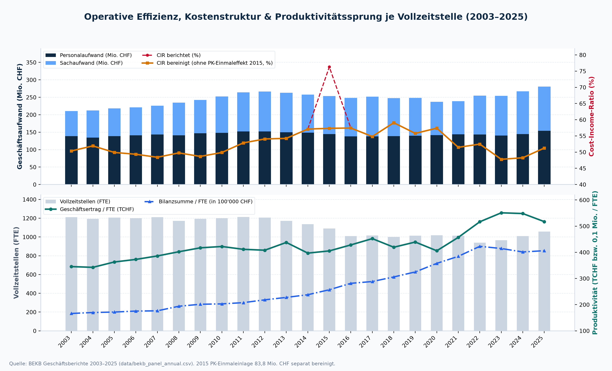

# Mehrjahresbericht 4: Operative Effizienz, Digitalisierung & Filialnetz-Transformation (2003–2025)

> **Datenbasis:** Bereinigte Jahresabschlüsse 2003–2025 (`data/bekb_panel_annual.csv`). Hinweis: Ab 2015 Rechnungslegung nach FINMA-RVB; 2015 enthält eine einmalige PK-Zuweisung (83,8 Mio. CHF).

## 1. Management Summary

- **Starke Steigerung der Produktivität pro Vollzeitstelle:** Zwischen 2003 und 2025 sank der Personalbestand (FTE) um **–12,6 %** (von **1'210 FTE** auf **1'058 FTE**; Tiefststand 2022: **940 FTE**), während sich die Bilanzsumme je FTE von **16,63 Mio. CHF (2003)** auf **40,62 Mio. CHF (2025, +144,3 %)** und der Geschäftsertrag je FTE von **345,5 TCHF** auf **517,3 TCHF (+49,7 %)** erhöhten.
- **Disziplinierte Cost-Income-Ratio (CIR):** Trotz steigender IT- und Regulatorik-Ausgaben blieb die operative CIR meist nahe oder unter **55 %** (Spitzenwerte in der Zinswende: **2023: 47,8 %**; **2024: 48,3 %**; **2025: 51,3 %**).
- **Einmaleffekt 2015 sauber isoliert:** Die ausgewiesene CIR 2015 von **76,3 %** resultiert ausschliesslich aus der einmaligen Stärkung der BEKB-Pensionskasse (**83,8 Mio. CHF**); bereinigt betrug der Geschäftsaufwand **253,6 Mio. CHF** (CIR bereinigt: **57,4 %**).
- **Wandel des Standortnetzes:** Die klassischen Niederlassungen wurden bis 2019 von **79 (2011/2012)** auf **60 (2019)** reduziert. Mit der «Strategie 2025» erfasste die BEKB ab **2020** breiter sämtliche *Standorte* (Smart- und Beratungscenter: **81** in 2020 $\rightarrow$ **72** in 2024/2025).

## 2. Quantitative Entwicklung & Visuelle Analyse

### Phasenvergleich

| Phase | Ø Geschäftsaufwand (Mio.) | Ø CIR (%) | Ø CIR bereinigt (%) | Ø FTE | Ø Ertrag / FTE (TCHF) | Ø Bilanzsumme / FTE (Mio.) |
| :--- | :---: | :---: | :---: | :---: | :---: | :---: |
| 2003–2014 (Expansion & Filialnetz) | 240,4 | 51,4 % | 51,4 % | 1'193 | 392,2 | 19,59 |
| 2015–2022 (Konsolidierung & App) | 258,1 | 58,1 % | 55,7 % | 1'013 | 440,6 | 32,79 |
| 2023–2025 (Zinswende & Tech-Ausbau) | 267,3 | 49,1 % | 49,1 % | 1'011 | 538,8 | 40,74 |

### Vollständige Effizienz- & Produktivitätszeitreihe (2003–2025)

| Jahr | Geschäftsaufwand (Mio.) | Personalaufwand (Mio.) | Sachaufwand (Mio.) | CIR (%) | CIR bereinigt (%) | FTE | Standorte | Ertrag / FTE (TCHF) | Bilanzsumme / FTE (Mio.) | AuM / FTE (Mio.) |
| :---: | :---: | :---: | :---: | :---: | :---: | :---: | :---: | :---: | :---: | :---: |
| 2003 | 210,6 | 138,5 | 72,1 | 50,4 % | 50,4 % | 1'210 | 77 | 345,5 | 16,63 | 15,0 |
| 2004 | 212,3 | 134,5 | 77,7 | 51,9 % | 51,9 % | 1'193 | 77 | 342,6 | 17,00 | 14,6 |
| 2005 | 218,5 | 138,5 | 80,0 | 49,9 % | 49,9 % | 1'206 | 76 | 363,1 | 17,18 | 15,7 |
| 2006 | 221,0 | 140,8 | 80,3 | 49,4 % | 49,4 % | 1'201 | 77 | 372,9 | 17,55 | 16,7 |
| 2007 | 226,2 | 143,6 | 82,6 | 48,4 % | 48,4 % | 1'210 | 78 | 386,1 | 17,65 | 16,9 |
| 2008 | 234,6 | 140,8 | 93,8 | 49,8 % | 49,8 % | 1'172 | 78 | 402,2 | 19,39 | 16,0 |
| 2009 | 242,3 | 146,8 | 95,5 | 48,7 % | 48,7 % | 1'193 | 77 | 417,2 | 20,15 | 17,0 |
| 2010 | 252,6 | 147,9 | 104,7 | 49,9 % | 49,9 % | 1'199 | 78 | 422,3 | 20,30 | 17,1 |
| 2011 | 264,0 | 152,1 | 111,9 | 52,9 % | 52,9 % | 1'214 | 79 | 411,5 | 20,77 | 16,3 |
| 2012 | 266,3 | 152,3 | 114,1 | 54,1 % | 54,1 % | 1'207 | 79 | 408,1 | 21,85 | 17,1 |
| 2013 | 278,1 | 149,9 | 112,9 | 54,2 % | 54,2 % | 1'171 | 75 | 437,8 | 22,77 | 16,6 |
| 2014 | 257,8 | 148,4 | 109,4 | 57,1 % | 57,1 % | 1'137 | 73 | 397,0 | 23,80 | 18,6 |
| 2015 | 337,4 | 144,3 | 109,3 | 76,3 % | 57,4 % | 1'091 | 68 | 405,4 | 25,70 | 18,3 |
| 2016 | 248,3 | 137,8 | 110,5 | 57,5 % | 57,5 % | 1'009 | 67 | 428,3 | 28,15 | 20,8 |
| 2017 | 251,9 | 138,1 | 113,8 | 54,8 % | 54,8 % | 1'016 | 62 | 452,3 | 28,84 | 18,2 |
| 2018 | 247,8 | 138,8 | 109,0 | 59,1 % | 59,1 % | 1'000 | 60 | 419,5 | 30,59 | 17,5 |
| 2019 | 248,3 | 139,8 | 108,5 | 55,8 % | 55,8 % | 1'013 | 60 | 439,3 | 32,51 | 18,6 |
| 2020 | 237,2 | 141,9 | 95,3 | 57,4 % | 57,4 % | 1'018 | 81 | 405,9 | 35,78 | 18,4 |
| 2021 | 238,6 | 144,2 | 94,5 | 51,5 % | 51,5 % | 1'014 | 79 | 457,1 | 38,46 | 19,3 |
| 2022 | 254,9 | 143,4 | 111,5 | 52,5 % | 52,5 % | 940 | 76 | 516,7 | 42,29 | 18,1 |
| 2023 | 254,4 | 140,4 | 113,9 | 47,8 % | 47,8 % | 966 | 73 | 551,0 | 41,46 | 18,9 |
| 2024 | 267,0 | 144,4 | 122,5 | 48,3 % | 48,3 % | 1'009 | 72 | 548,2 | 40,14 | 20,2 |
| 2025 | 280,6 | 153,8 | 126,7 | 51,3 % | 51,3 % | 1'058 | 72 | 517,3 | 40,62 | 21,7 |

## 3. Treiberanalyse & Strukturelle Wendepunkte

1. **Verschiebung vom Personal- zum Sachaufwand (IT & Digitalisierung):** Während der Personalaufwand zwischen **2007 (143,6 Mio. CHF)** und **2024 (144,4 Mio. CHF)** nominal nahezu konstant gehalten wurde (erst **2025** Anstieg auf **153,8 Mio. CHF** durch gezielten Personalaufbau auf **1'058 FTE**), stieg der Sachaufwand strukturell von **72,1 Mio. CHF (2003)** auf **126,7 Mio. CHF (2025, +75,8 %)** – Spiegelbild der Investitionen in Kernbankensysteme, Cybersecurity, Regulatorik und die BEKB-App.
2. **Effizienzsprung 2015–2022 & Personalaufbau 2023–2025:** Nach der Stellenreduktion von **1'207 FTE (2012)** auf **940 FTE (2022)** steigerte die BEKB mit dem Wachstum im Beratungs-, Firmenkunden- und IT-Geschäft den Bestand bis **2025** gezielt wieder um +118 FTE auf **1'058 FTE**, hielt den Ertrag je FTE mit **517,3 TCHF** aber nahe den Rekordwerten von **2023 (551,0 TCHF)** und **2024 (548,2 TCHF)**.
3. **Standort-Reorganisation 2020:** Der rechnerische Anstieg von **60 (2019)** auf **81 Standorte (2020)** reflektiert den Übergang zur einheitlichen Standort-Statistik (Einbezug sämtlicher Beratungs- und Servicepunkte; Vorjahr 2019 angepasst ebenfalls 81), woraufhin bis **2024/2025** eine Konsolidierung auf **72 Standorte** erfolgte.

## 4. Fazit & Ausblick

Die BEKB beweist über zwei Dekaden eine bemerkenswerte Kostendisziplin: Selbst bei historischem Tiefstand des Zinsumfelds blieb die bereinigte CIR meist unter 59 %, um in der Zinswende sofort in das Zielband um **50 % (2025: 51,3 %)** zu fallen. Auch im **1. Halbjahr 2026** verbesserte sich die CIR weiter auf **49,1 %** (Geschäftsaufwand **142,9 Mio. CHF** bei **291,2 Mio. CHF** Geschäftsertrag) – ein starkes Indiz für operative Skalierbarkeit.
