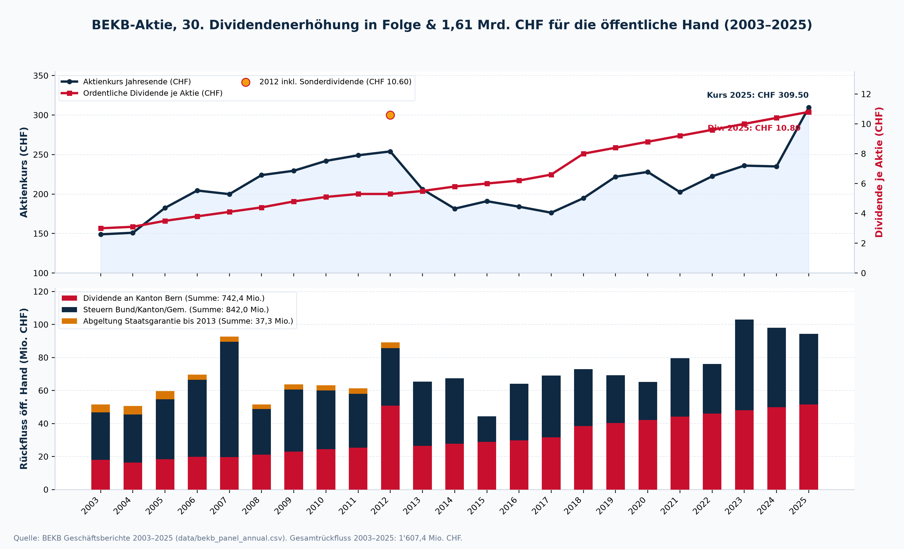

# Mehrjahresbericht 5: BEKB-Aktie, Dividendenkontinuität & Wertschöpfung für den Kanton Bern (2003–2025)

> **Datenbasis:** Bereinigte Jahres- & Aktiendaten 2003–2025 (`data/bekb_panel_annual.csv`). Hinweis: 2012 enthielt neben der ordentlichen Dividende (CHF 5.30) eine Sonderdividende von CHF 5.30; 2006/2007 bzw. 2008 erfolgten zusätzliche Nennwertrückzahlungen.

## 1. Management Summary

- **30. Dividendenerhöhung in Folge:** Die ordentliche Dividende je Namenaktie stieg ununterbrochen von **CHF 3.00 (2003)** auf **CHF 10.80 (2025, +260 %)** – dies markiert gemäss Geschäftsbericht 2025 die 30. ordentliche Dividendenerhöhung in Folge, bei einer moderaten **Ausschüttungsquote von 57 % (2025)**.
- **Rekord-Aktienkurs 2025:** Nach längerer Bandbreite zwischen CHF 176.40 (2017) und CHF 254.00 (2012) sprang die BEKB-Aktie **2025 um +31,7 % auf CHF 309.50** (2003: **CHF 149.00**; Kursplus **+107,7 %** zzgl. stetiger Dividendenrenditen zwischen **1,86 % und 4,54 %**).
- **Über 1,6 Mrd. CHF für die öffentliche Hand:** Kumuliert über **2003–2025** flossen insgesamt **1'621,7 Mio. CHF** an Bund, Kanton Bern und Gemeinden – davon **842,0 Mio. CHF** Steuern, **742,4 Mio. CHF** Dividenden an den Kanton Bern und **37,3 Mio. CHF** Abgeltung der Staatsgarantie (bis 2013).
- **Ausgewogene Substanzbildung:** Dem kumulierten Jahresgewinn von **3'108,8 Mio. CHF (2003–2025)** standen Ausschüttungsquoten um **53–57 %** gegenüber, wodurch laufend Eigenkapital über Gewinnreserven und Reserven für allgemeine Bankrisiken thesauriert werden konnte.

## 2. Quantitative Entwicklung & Visuelle Analyse

### Phasenvergleich

| Phase | Ø Aktienkurs (CHF) | Dividende Start $\rightarrow$ Ende (CHF) | Ø Div.-Rendite (%) | Kum. Steuern (Mio.) | Kum. Dividende Kanton (Mio.) | Kum. Garantieabgeltung (Mio.) | Kum. Rückfluss Total (Mio.) |
| :--- | :---: | :---: | :---: | :---: | :---: | :---: | :---: |
| 2003–2012 (Epoche 1: FCF/NEM) | 208.55 | 3.00 $\rightarrow$ 5.30* | 2,03 % | 378,6 | 237,3 | 37,2 | 653,1 |
| 2013–2019 (Epoche 2: Langfrist) | 193.67 | 5.50 $\rightarrow$ 8.40 | 3,43 % | 229,1 | 223,2 | 0,1 | 452,4 |
| 2020–2025 (Epoche 3: Strategie 2025) | 238.92 | 8.80 $\rightarrow$ 10.80 | 4,14 % | 234,3 | 281,9 | 0,0 | 516,2 |
| **Gesamt 2003–2025** | **211.94** | **3.00 $\rightarrow$ 10.80** | **3,01 %** | **842,0** | **742,4** | **37,3** | **1'621,7** |

### Vollständige Aktie- & Wertschöpfungszeitreihe (2003–2025)

| Jahr | Aktienkurs 31.12. (CHF) | Dividende (CHF) | Div.-Rendite (%) | Ausschüttungsquote (%) | Free Cash Flow (Mio.) | Steuern öff. Hand (Mio.) | Dividende an Kanton (Mio.) | Abgeltung Staatsgarantie (Mio.) | Total Rückfluss öff. Hand (Mio.) |
| :---: | :---: | :---: | :---: | :---: | :---: | :---: | :---: | :---: | :---: |
| 2003 | 149.00 | 3.00 | 2,01 % | – | 125,5 | 28,8 | 18,0 | 4,8 | 51,6 |
| 2004 | 151.00 | 3.10 | 2,05 % | – | 116,7 | 29,1 | 16,4 | 5,1 | 50,6 |
| 2005 | 182.50 | 3.50 | 1,92 % | – | 135,5 | 36,2 | 18,4 | 5,1 | 59,7 |
| 2006 | 204.50 | 3.80 | 1,86 % | – | 135,5 | 46,6 | 19,9 | 3,2 | 69,7 |
| 2007 | 199.90 | 4.10 | 2,05 % | – | 121,7 | 69,9 | 19,7 | 3,0 | 92,6 |
| 2008 | 224.00 | 4.40 | 1,96 % | – | 130,5 | 27,6 | 21,1 | 2,9 | 51,6 |
| 2009 | 229.50 | 4.80 | 2,09 % | – | 147,0 | 37,5 | 23,0 | 3,2 | 63,7 |
| 2010 | 242.00 | 5.10 | 2,11 % | – | 118,0 | 35,5 | 24,5 | 3,2 | 63,2 |
| 2011 | 249.10 | 5.30 | 2,13 % | – | 120,0 | 32,6 | 25,4 | 3,3 | 61,3 |
| 2012 | 254.00 | 5.30 | 2,09 % | – | 107,8 | 34,8 | 50,9 | 3,4 | 89,1 |
| 2013 | 206.00 | 5.50 | 2,67 % | – | 155,7 | 38,9 | 26,4 | 0,1 | 65,4 |
| 2014 | 181.50 | 5.80 | 3,20 % | – | 128,3 | 39,7 | 27,8 | 0,0 | 67,5 |
| 2015 | 191.00 | 6.00 | 3,14 % | – | 73,1 | 15,5 | 28,8 | – | 44,3 |
| 2016 | 184.00 | 6.20 | 3,37 % | – | 94,2 | 34,2 | 29,8 | – | 64,0 |
| 2017 | 176.40 | 6.60 | 3,74 % | 45 % | 78,1 | 37,4 | 31,7 | – | 69,1 |
| 2018 | 194.80 | 8.00 | 4,11 % | 53 % | 132,2 | 34,5 | 38,4 | – | 72,9 |
| 2019 | 222.00 | 8.40 | 3,78 % | 55 % | 90,6 | 28,9 | 40,3 | – | 69,2 |
| 2020 | 228.00 | 8.80 | 3,86 % | 55 % | 97,2 | 23,0 | 42,2 | – | 65,2 |
| 2021 | 202.50 | 9.20 | 4,54 % | 55 % | 98,9 | 35,4 | 44,2 | – | 79,6 |
| 2022 | 222.50 | 9.60 | 4,31 % | 56 % | 118,1 | 29,9 | 46,1 | – | 76,0 |
| 2023 | 236.00 | 10.00 | 4,24 % | 53 % | 211,8 | 55,0 | 48,0 | – | 103,0 |
| 2024 | 235.00 | 10.40 | 4,43 % | 54 % | 203,4 | 48,2 | 49,9 | – | 98,1 |
| 2025 | 309.50 | 10.80 | 3,49 % | 57 % | 182,2 | 42,8 | 51,5 | – | 94,3 |

## 3. Treiberanalyse & Strukturelle Wendepunkte

1. **Ende der Staatsgarantie & Sonderdividende 2012:** Nach Erfüllung des 10-Jahres-FCF-Ziels krönte die BEKB das Jahr **2012** mit einer Verdopplung der Ausschüttung via Sonderdividende (**5.30 CHF + 5.30 CHF**; Dividendenzahlung an den Kanton Bern **50,9 Mio. CHF**). Mit dem gesetzlichen Wegfall der Staatsgarantie sank die Garantieabgeltung an den Kanton von **3,4 Mio. CHF (2012)** auf **0,1 Mio. CHF (2013)** und entfiel ab **2014** vollständig.
2. **Starke Dividenden-Stufe 2018:** Nach der Abschaffung der Staatsgarantie und der soliden Eigenkapitalausstattung unter FINMA-RVB hob die BEKB die ordentliche Dividende 2018 deutlich von **CHF 6.60 auf CHF 8.00 (+21,2 %)** an und führte den jährlichen +CHF-0.40-Steigerungspfad bis **CHF 10.80 (2025)** fort.
3. **Steuereffekte in Sonderjahren:** Ausreisser bei den geleisteten Steuern traten **2007 (69,9 Mio. CHF)** infolge der steuerpflichtigen BKW-Beteiligungsgewinne sowie **2015 (15,5 Mio. CHF)** durch die steuermindernde Pensionskassen-Einmaleinlage auf; in der Zinswende **2023–2025** flossen jeweils **42,8 bis 55,0 Mio. CHF** pro Jahr an Steuern sowie **48,0 bis 51,5 Mio. CHF** an Kantonsdividende.

## 4. Fazit & Ausblick

Die BEKB-Aktie verbindet für den Hauptaktionär Kanton Bern (~51,5 % Beteiligung) wie auch für rund 50'000–60'000 Publikumsaktionäre hohe Ertragsstabilität mit planbarer Dividendenprogression. Bei einem Kursniveau von **CHF 309.50 (Ende 2025)** entspricht die Dividende von **CHF 10.80** einer Ausschüttungsrendite von **3,49 %**, während der Halbjahresgewinn **H1-2026 (82,6 Mio. CHF, +8,3 %)** eine nahtlose Fortsetzung der Ausschüttungspolitik unterstützt.
