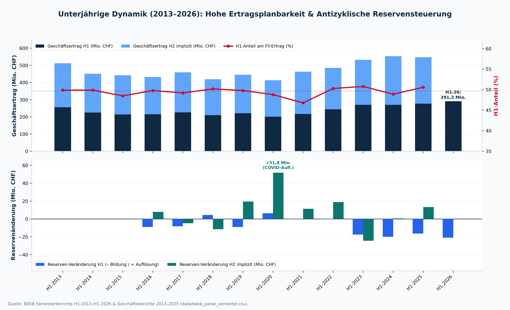

# Mehrjahresbericht 6: Unterjährige Dynamik & Halbjahres-Muster (Semesterberichte 2013–2026)

> **Datenbasis:** Alle 14 Semesterberichte (`H1-2013` bis `H1-2026`, jeweils per 30. Juni) abgeglichen mit den Geschäftsberichten 2013–2025 (`data/bekb_panel_semester.csv`). Hinweis: Negative Werte bei *Reserven-Dotierung* entsprechen gemäss Erfolgsrechnungsschema Zuweisungen (Aufwand/Bildung) an die Reserven für allgemeine Bankrisiken, positive Werte entsprechen Auflösungen.

## 1. Management Summary

- **Hohe saisonale Planbarkeit beim Ertrag:** Im langjährigen Durchschnitt (`2013–2025`) erzielt die BEKB exakt **49,5 %** ihres Gesamtjahres-Geschäftsertrags im 1. Semester (enge Bandbreite von **46,8 % in H1-2021** bis **50,8 % in H1-2023**).
- **Gewinn-Glättung über Reserven für allgemeine Bankrisiken:** Beim ausgewiesenen Periodengewinn liegt der H1-Anteil seit FINMA-RVB (`2015–2025`) bei durchschnittlich **41,9 %** (`2013–2025`: **42,4 %**). Je nach Jahresverlauf steuert das Management H1- vs. H2-Reservenbildung gegenläufig (z. B. 2023: Dotierung **-17,4 Mio. CHF** im H1 und **-24,4 Mio. CHF** im H2; 2020: Auflösung **+6,4 Mio. CHF** im H1 und **+51,8 Mio. CHF** im H2).
- **Rekordstart im H1-2026:** Im ersten Halbjahr 2026 erreichte der Geschäftsertrag **291,2 Mio. CHF (+5,1 % ggü. H1-2025)**, der Geschäftserfolg **127,8 Mio. CHF (+12,3 %)** und der Halbjahresgewinn **82,6 Mio. CHF (+8,3 %)**, bei einer hervorragenden **CIR von 49,1 %**.
- **Indikative Hochrechnung für FY2026:** Unter Anwendung des historischen Saisonmusters (`Ø H1/FY`) entspricht H1-2026 rechnerisch einem Jahres-Geschäftsertrag von rund **588,2 Mio. CHF** und einem Jahresgewinn von rund **197,2 Mio. CHF** (rein indikative Trendextrapolation vorbehältlich H2-Reservenbildung).

## 2. Quantitative Entwicklung & Visuelle Analyse

### Phasenvergleich

| Zeitraum | Anzahl H1-Berichte | Ø Geschäftsertrag H1 (Mio.) | Ø Reingewinn H1 (Mio.) | Ø H1-Anteil am FY-Ertrag (%) | Ø H1-Anteil am FY-Gewinn (%) |
| :--- | :---: | :---: | :---: | :---: | :---: |
| 2013–2014 (Vorgänger-Rechnungslegung) | 2 | 240,6 | 58,5 | 49,9 % | 44,9 % |
| 2015–2022 (Negativzins-Ära / RVB) | 8 | 218,8 | 59,4 | 49,2 % | 41,6 % |
| 2023–2025 (Zinswende-Jahre) | 3 | 272,6 | 75,7 | 50,1 % | 42,8 % |
| **H1-2026 (Aktuellstes Semester)** | **1** | **291,2** | **82,6** | – | – |

### Vollständige Semester- & Saisonalitätstabelle (H1-2013–H1-2026)

| Halbjahr | Bilanzsumme (Mio.) | Netto-Zinserfolg H1 (Mio.) | Kommission H1 (Mio.) | Geschäftsertrag H1 (Mio.) | Geschäftserfolg H1 (Mio.) | Reingewinn H1 (Mio.) | CIR H1 (%) | Anteil Ertrag H1/FY (%) | Anteil Gewinn H1/FY (%) | Reserven-Dot. H1 / H2 impl. (Mio.) |
| :---: | :---: | :---: | :---: | :---: | :---: | :---: | :---: | :---: | :---: | :---: |
| H1-2013 | 26'459,3 | 160,3 | 39,1 | 256,1 | 107,6 | 59,2 | 58,0 % | 49,9 % | 45,5 % | – |
| H1-2014 | 27'075,9 | 154,3 | 39,3 | 225,1 | 92,7 | 57,8 | 58,8 % | 49,9 % | 44,3 % | – |
| H1-2015 | 28'030,1 | 142,0 | 49,6 | 214,3 | 86,6 | 56,4 | 59,6 % | 48,5 % | 43,0 % | – |
| H1-2016 | 28'714,8 | 150,4 | 47,3 | 215,2 | 72,9 | 55,4 | 59,0 % | 49,8 % | 42,8 % | -9,0 / 8,0 |
| H1-2017 | 29'340,0 | 152,8 | 52,8 | 226,0 | 79,7 | 56,9 | 55,8 % | 49,2 % | 41,4 % | -8,1 / -4,8 |
| H1-2018 | 30'317,7 | 135,7 | 53,0 | 210,4 | 65,5 | 58,0 | 60,1 % | 50,2 % | 41,2 % | 4,5 / -11,5 |
| H1-2019 | 32'353,1 | 146,7 | 51,8 | 221,7 | 79,7 | 59,1 | 56,5 % | 49,8 % | 41,4 % | -8,9 / 19,4 |
| H1-2020 | 35'429,8 | 130,4 | 54,5 | 201,7 | 64,1 | 60,1 | 60,0 % | 48,8 % | 40,5 % | 6,4 / 51,8 |
| H1-2021 | 37'562,1 | 141,9 | 55,5 | 217,0 | 76,5 | 63,6 | 55,4 % | 46,8 % | 41,1 % | 0,2 / 11,4 |
| H1-2022 | 39'187,8 | 165,1 | 56,6 | 244,3 | 81,1 | 66,0 | 51,5 % | 50,3 % | 41,3 % | -0,1 / 19,0 |
| H1-2023 | 39'936,1 | 195,1 | 52,5 | 270,2 | 115,7 | 75,6 | 48,0 % | 50,8 % | 43,2 % | -17,4 / -24,4 |
| H1-2024 | 39'816,0 | 188,7 | 56,3 | 270,5 | 118,0 | 75,3 | 49,6 % | 48,9 % | 41,7 % | -19,9 / 0,7 |
| H1-2025 | 41'893,4 | 191,4 | 62,6 | 277,0 | 113,8 | 76,3 | 50,6 % | 50,6 % | 43,5 % | -16,2 / 13,2 |
| H1-2026 | 44'654,9 | 183,3 | 70,1 | 291,2 | 127,8 | 82,6 | 49,1 % | – | – | -21,0 / – |

## 3. Treiberanalyse & Strukturelle Wendepunkte

1. **Reserven-Steuerung als Stabilitätsanker:** Der Abgleich von `H1` und `FY` belegt, wie konsequent die BEKB Ergebnisschwankungen über die *Reserven für allgemeine Bankrisiken* ausgleicht: Im Zinswende-Jahr **2023** wies die Bank im H1 einen Reingewinn von **75,6 Mio. CHF (43,2 % des FY-Gewinns)** aus, bildete im H1 **17,4 Mio. CHF** und im H2 nochmals **24,4 Mio. CHF** zusätzliche Reserven. Im Pandemiejahr **2020** hingegen stützte eine massive H2-Reservenauflösung (**+51,8 Mio. CHF**) das Jahresergebnis.
2. **Ergebnis-Sprung im H1-2026:** Im Vergleich zu **H1-2025** gingen die Netto-Zinserträge leicht auf **183,3 Mio. CHF** zurück, doch wuchsen Kommissionen (**70,1 Mio. CHF**) und Handelsertrag (**14,2 Mio. CHF**) dynamisch; gleichzeitig wies die Bank bereits im H1-2026 weitere **21,0 Mio. CHF** den Reserven für allgemeine Bankrisiken zu und erzielte dennoch **82,6 Mio. CHF** Reingewinn.

## 4. Fazit & Ausblick

Der Abgleich der 14 Semesterberichte zeigt eine hochgradig verlässliche unterjährige Saisonalität (Ø **49,5 %** des Geschäftsertrags und **41,9 %** des Reingewinns unter FINMA-RVB im 1. Semester). Mit **291,2 Mio. CHF** Geschäftsertrag und **82,6 Mio. CHF** Halbjahresgewinn sowie der parallelen Kapitalbasis aus `06-2026` (**18,04 % CET1**) steuert die BEKB auf eines der stärksten Gesamtjahre ihrer jüngeren Geschichte zu.
