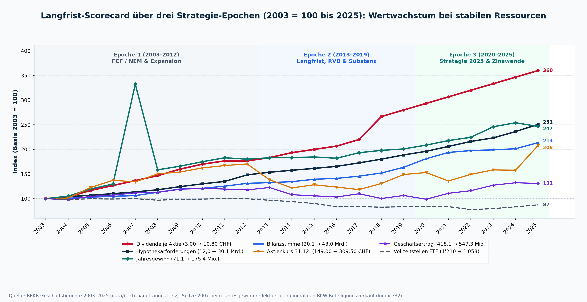
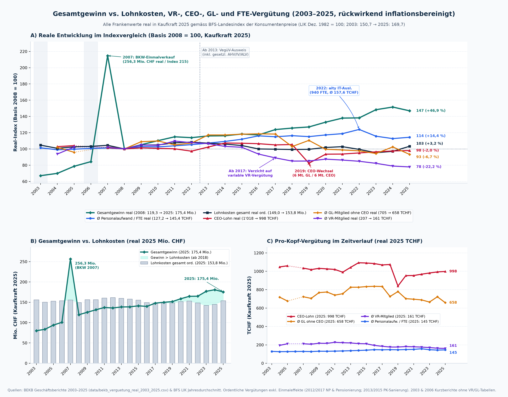

# Mehrjahresbericht 7: Strategische Epochen, Nachhaltigkeit & Governance im Wandel (2003–2026)

> **Datenbasis:** Synthese aus Lageberichten, Corporate-Governance-Kapiteln und quantitativem Gesamtpanel (2003–H1-2026) gemäss `ANALYSE_STRATEGIE.md` sowie inflationsbereinigtem Vergütungs-Panel (`data/bekb_verguetung_real_2003_2025.csv`, BFS LIK Jahresdurchschnitt, Basis 2025 = 100 %).

## 1. Management Summary

- **Drei konsistente strategische Epochen ohne Zickzackkurs:** Über 24 Berichtsjahre hinweg verfolgte die BEKB konsequent eine Strategie der regionalen Verankerung (Espace Mittelland / Kantone Bern und Solothurn), des bewussten Verzichts auf hochrisikobehaftetes Investmentbanking und des stetigen Substanzaufbaus.
- **Vom FCF-Ziel zur Ökosystem- und Nachhaltigkeitsbank:** Während **Epoche 1 (2003–2012)** durch das quantitative 10-Jahres-Ziel «800 Mio. bis 1 Mrd. CHF Free-Cash-Flow» und den Abschied von der Staatsgarantie geprägt war, standen in **Epoche 2 (2013–2019)** Eigenmittelstärke unter FINMA-RVB, der BEKB-Förderfonds und die Standortbereinigung im Fokus. **Epoche 3 (2020–2026)** verankerte mit der **«Strategie 2025»** Ökosysteme (Wohnen, Vorsorge, KMU), GRI-konforme Nachhaltigkeitsberichterstattung und die digitale Transformation.
- **Reale Entkopplung von Gewinnwachstum und Spitzenvergütungen (2004–2025, real 2025 CHF):** Während der inflationsbereinigte **Gesamtgewinn** um **+110,1 %** (**83,5** $\rightarrow$ **175,4 Mio. CHF**; ggü. 2008: **+46,9 %**) stieg, legte der reale **Personalaufwand je FTE** um **+15,5 %** (**125,9** $\rightarrow$ **145,4 TCHF**) zu und die gesamten realen **Lohnkosten** blieben praktisch stabil (**+2,4 %**). Gleichzeitig gingen die realen Durchschnittsvergütungen von **VR-Mitgliedern (-17,0 %)**, **GL-Mitgliedern ohne CEO (-8,4 %)** und **CEO (-4,7 %)** zurück.
- **Kontinuität in der Governance:** Trotz Generationenwechseln an der Spitze – aktuell mit der Wahl von **Dr. Annelis Lüscher Hämmerli zur Verwaltungsratspräsidentin im H1 2026** neben CEO Armin Brun – blieben Risikoprofil, Ausschüttungskontinuität (30 Jahre ununterbrochene Dividendenerhöhung) und Kapitalresilienz (**CET1 06-2026: 18,04 %**) unverändert stabil.

## 2. Quantitative Entwicklung & Langfrist-Scorecard

| Epoche | Zeitraum | Bilanzsumme Start $\rightarrow$ Ende (Mio.) | Hypotheken Start $\rightarrow$ Ende (Mio.) | Ø Geschäftsertrag (Mio.) | Ø Jahresgewinn (Mio.) | Ø CIR bereinigt (%) | Dividende Start $\rightarrow$ Ende (CHF) | Ø CET1-Quote (%) |
| :--- | :---: | :---: | :---: | :---: | :---: | :---: | :---: | :---: |
| **Epoche 1: FCF / NEM & Expansion** | 2003–2012 | 20'117,0 $\rightarrow$ 26'371,2 | 12'004,0 $\rightarrow$ 17'794,9 | 464,7 | 117,3 | 50,5 % | 3.00 $\rightarrow$ 5.30* | – |
| **Epoche 2: Langfrist & Substanz** | 2013–2019 | 26'663,4 $\rightarrow$ 32'929,8 | 18'440,4 $\rightarrow$ 22'663,5 | 451,8 | 134,6 | 56,6 % | 5.50 $\rightarrow$ 8.40 | 19,23 % |
| **Epoche 3: Strategie 2025 & Heute** | 2020–2025 (+H1-26) | 36'421,7 $\rightarrow$ 44'654,9 | 23'537,7 $\rightarrow$ 31'057,1 | 499,2 | 165,6 | 51,4 % | 8.80 $\rightarrow$ 10.80 | 17,83 % |

### Inflationsbereinigte Gewinn-, Lohn- und Vergütungsentwicklung (real 2025 CHF)

> **Methodik & Bereinigungen:** Rückwirkende Teuerungsbereinigung mit dem **BFS Landesindex der Konsumentenpreise (LIK Jahresdurchschnitt, Basis 2025 = 169,7 Punkte)**. Ausgewiesen sind jeweils die **ordentlichen** Gesamtvergütungen (inkl. Vorsorgeleistungen und ab 2013 VegüV inkl. gesetzlicher AHV/IV/ALV; 2012/2017 ohne einmalige 10-Jahres-Nachhaltigkeitsprämie bzw. Pensionierungsabgeltungen; ordentlicher Personalaufwand ohne PK-Einmalzuweisungen 2013/2015). Pro-Kopf-Werte bei VR und GL berücksichtigen unterjährige Ein-/Austritte und Kündigungsfristen exakt pro rata temporis (2025 GL gemäss GB S. 2316 explizit teilzeitbereinigt `6,6 FTE`). Kurzberichte 2003 & 2006 publizierten keine VR/CEO/GL-Tabellen.

| Jahr | BFS LIK (Dez. 82=100) | Faktor 2025 | Gesamtgewinn real (Mio.) | Lohnkosten gesamt real (Mio.) | Ø Personalaufw./FTE real (TCHF) | Ø VR-Mitglied real (TCHF) | CEO-Lohn real (TCHF) | Ø GL ohne CEO real (TCHF) |
| :---: | :---: | :---: | :---: | :---: | :---: | :---: | :---: | :---: |
| 2003 | 150,7 | 1,126 | 80,1 | 156,0 | 128,9 | – | – | – |
| 2004 | 152,0 | 1,116 | 83,5 | 150,2 | 125,9 | 194,3 | 1'047,2 | 719,0 |
| 2005 | 153,7 | 1,104 | 93,9 | 152,9 | 126,8 | 212,0 | 1'059,9 | 676,3 |
| 2006 | 155,4 | 1,092 | 100,7 | 153,7 | 128,0 | – | – | – |
| 2007 | 156,5 | 1,084 | 256,3 | 155,7 | 128,7 | 211,9 | 1'034,5 | 723,4 |
| 2008 | 160,3 | 1,059 | 119,3 | 149,0 | 127,2 | 207,3 | 1'018,4 | 705,4 |
| 2009 | 159,5 | 1,064 | 125,5 | 156,2 | 130,9 | 217,4 | 1'032,0 | 768,2 |
| 2010 | 160,6 | 1,057 | 131,5 | 156,3 | 130,4 | 216,3 | 1'026,0 | 774,8 |
| 2011 | 161,0 | 1,054 | 137,2 | 160,3 | 132,0 | 227,4 | 1'020,3 | 740,7 |
| 2012 | 159,9 | 1,061 | 135,9 | 161,6 | 133,9 | 223,3 | 990,2 | 756,4 |
| 2013 | 159,5 | 1,064 | 138,5 | 159,5 | 136,2 | 220,8 | 1'042,7 | 826,7 |
| 2014 | 159,5 | 1,064 | 138,7 | 157,9 | 138,9 | 213,7 | 1'092,7 | 826,7 |
| 2015 | 157,7 | 1,076 | 141,3 | 155,3 | 142,3 | 211,6 | 1'090,1 | 833,6 |
| 2016 | 157,0 | 1,081 | 139,9 | 149,0 | 147,7 | 194,2 | 1'084,1 | 836,6 |
| 2017 | 157,8 | 1,075 | 147,8 | 148,6 | 146,2 | 184,4 | 1'069,0 | 834,5 |
| 2018 | 159,3 | 1,065 | 150,0 | 147,9 | 147,9 | 176,3 | 1'073,8 | 726,0 |
| 2019 | 159,9 | 1,061 | 151,6 | 148,3 | 146,4 | 176,4 | 839,5 | 779,6 |
| 2020 | 158,7 | 1,069 | 158,7 | 151,7 | 149,1 | 181,2 | 952,8 | 702,3 |
| 2021 | 159,7 | 1,063 | 164,6 | 153,2 | 151,1 | 178,9 | 954,2 | 696,5 |
| 2022 | 164,2 | 1,033 | 165,0 | 148,2 | 157,7 | 175,8 | 968,4 | 688,8 |
| 2023 | 167,7 | 1,012 | 177,0 | 142,1 | 147,1 | 170,6 | 981,6 | 665,6 |
| 2024 | 169,5 | 1,001 | 180,9 | 144,6 | 143,3 | 163,6 | 993,2 | 722,9 |
| 2025 | 169,7 | 1,000 | 175,4 | 153,8 | 145,4 | 161,3 | 998,0 | 658,4 |

## 3. Treiberanalyse & Strukturelle Wendepunkte

1. **Epoche 1 (2003–2012) – «Free Cash Flow / Netto erarbeitete Mittel (NEM)»:**
   - Zielsetzung eines 10-Jahres-Mehrwerts (FCF) von **800 Mio. bis 1'000 Mio. CHF** basierend auf einem Ziel-Eigenkapital von ~1 Mrd. CHF (~120 % der gesetzlichen Vorgabe).
   - Schrittweise Veräusserung nicht-strategischer Beteiligungen (u. a. BKW-Aktienpakete 2006/2007 zur Reservenstärkung und Nennwertrückzahlung 2008), Verbreiterung des Aktionariats auf über **56'000 Mitbesitzer** und gezielte KMU-/Startup-Förderung (z. B. MedTech/BioTech-Programme ab 2006).
   - Krönender Abschluss 2012: Ziel deutlich übertroffen, **Sonderdividende von CHF 5.30**, danach Ende der Staatsgarantie ab 2013/2014.
2. **Epoche 2 (2013–2019) – «Langfristige Ausrichtung, FINMA-RVB & Nachhaltigkeit»:**
   - Nach dem Ende der Staatsgarantie (Garantieabgeltung fiel von **3,4 Mio. CHF** 2012 auf **0,1 Mio. CHF** 2013 bzw. **0,0 Mio. CHF** 2014) richtete sich die Bank noch stärker auf autonome Eigenmittelstärke aus (CET1-Quote 2015–2019 durchgehend zwischen **18,60 % und 19,93 %**).
   - Governance-Reform ab **1. Januar 2017**: Abschaffung der variablen Vergütungskomponente für den Verwaltungsrat, wodurch das reale VR-Salär pro Sitz bis 2025 um **–22,2 %** gegenüber 2008 sank (**207,3** $\rightarrow$ **161,3 TCHF**).
   - Rechnungslegungswechsel auf **FINMA-RVB (2015)** und einmalige **83,8-Mio.-CHF-Sanierungseinlage in die Pensionskasse** zur Absenkung des technischen Zinssatzes von 2,5 % auf 2,0 % – getragen durch vorher gebildete Reserven.
   - Start des BEKB-Förderfonds und Straffung der klassischen Filialzahl auf **60 (2019)** bei sinkendem Vollzeitbestand (**1'171 FTE** 2013 $\rightarrow$ **1'013 FTE** 2019).
3. **Epoche 3 (2020–2026) – «Strategie 2025, Digitalisierung & Governance-Übergang»:**
   - Lancierung der **«Strategie 2025»** im Pandemiejahr **2020**: Fokus auf digitale Kundenzugänge (BEKB-App, Kundenportal), smarte Standortformate (**72 Standorte** 2024/2025) und Integration von ESG-/Klima-Kriterien gemäss **GRI-Standards** (eigener Nachhaltigkeitsbericht).
   - Nahtlose Beherrschung externer Schocks (COVID-19 2020, CS-Krise Frühjahr 2023, Zinswende 2022–2024, **Basel III final ab 2025**) bei Rekordgewinnen (**180,7 Mio. CHF** in 2024; **175,4 Mio. CHF** in 2025) und geordnetem Wechsel im Verwaltungsratspräsidium im **1. Halbjahr 2026**.

## 4. Fazit & Ausblick

Der Langfristvergleich 2003–2026 verdeutlicht, dass die überdurchschnittliche Stabilität der BEKB kein Zufallsprodukt einzelner Zinszyklen ist, sondern aus drei konstanten Governance-Pfeilern erwächst: konsequente Fokussierung auf den Heimatmarkt, konservative Kredit- und Handelsrisikopolitik sowie antizyklische Reservenbildung – flankiert von einer zurückhaltenden Vergütungspolitik auf VR- und GL-Stufe bei real steigendem Aufwand pro Vollzeitstelle. Mit einer **Bilanzsumme von 44'654,9 Mio. CHF (H1-2026)**, einem **Halbjahresgewinn von 82,6 Mio. CHF (+8,3 %)**, einer **CIR von 49,1 %** und einer **CET1-Quote von 18,04 %** unter Basel III final startet die neue Führungsriege um VR-Präsidentin Dr. Annelis Lüscher Hämmerli und CEO Armin Brun aus einer Position historischer Stärke in den nächsten Strategiezyklus.
