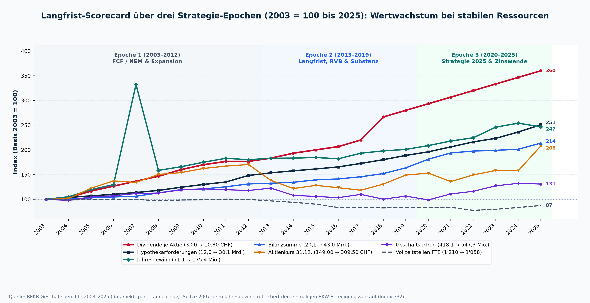

# BEKB Mehrjahresanalysen (2003–2026)

Dieser Ordner enthält die **7 konsolidierten Mehrjahresberichte** sowie **12 Visualisierungen (`charts/`)**, generiert aus allen **57 Geschäfts-, Semester- und Offenlegungsberichten** (`.md/*.md`) gemäss der Pipeline in [`ANALYSE_STRATEGIE.md`](../ANALYSE_STRATEGIE.md).

## Eckwerte auf einen Blick

| Kennzahl | 2003 | 2015 | 2025 | H1 / 06-2026 |
| :--- | :---: | :---: | :---: | :---: |
| Bilanzsumme (Mio. CHF) | 20'117,0 | 28'034,7 | **42'977,0** | **44'654,9** |
| Hypothekarforderungen (Mio. CHF) | 12'004,0 | 19'377,5 | **30'099,6** | **31'057,1** |
| Kundeneinlagen (Mio. CHF) | 13'709,7 | 22'082,9 | **28'086,7** | **28'754,4** |
| Geschäftsertrag (Mio. CHF) | 418,1 | 442,2 | **547,3** | 291,2 (H1) |
| Jahres- / Halbjahresgewinn (Mio. CHF) | 71,1 | 131,3 | **175,4** | 82,6 (H1) |
| Cost-Income-Ratio (%) | 50,4 % | 57,4 % (ber.) | **51,3 %** | **49,1 %** |
| Dividende je Aktie (CHF) | 3.00 | 6.00 | **10.80** | – |
| CET1-Quote / Gesamtkapital (%) | – | 19,47 / 19,61 | 18,28 / 20,39 | **18,04 % / 20,08 %** |

## Berichtskatalog & Grafiken

1. [01 – Zinszyklen & Ertragsarchitektur im Wandel (2003–2025)](./01_zinszyklen_und_ertragsarchitektur_2003_2025.md) — inkl. **Wasserfalldiagramm (Erfolgsrechnung 2025)** & **Kombiniertes Säulen-/Liniendiagramm**
2. [02 – Bilanzwachstum, Hypothekarmarkt & Refinanzierungskraft (2003–2026)](./02_bilanzwachstum_hypotheken_und_refinanzierung_2003_2026.md) — inkl. **Gestapelte Bilanzsäulen (absolut & 100 %)**, **Treemap**, **Sankey-Diagramm** & **Langfrist-Bilanzwachstum**
3. [03 – Aufsichtsrechtliche Resilienz & Basel-III-Evolution (2015–2026)](./03_aufsichtsrechtliche_resilienz_basel_iii_2015_2026.md) — inkl. **Horizontaler Soll-Ist-Vergleich** & **Basel-III-Zeitreihe**
4. [04 – Operative Effizienz, Digitalisierung & Filialnetz-Transformation (2003–2025)](./04_operative_effizienz_und_transformation_2003_2025.md) — inkl. **Kosten-/CIR- & Produktivitätschart**
5. [05 – BEKB-Aktie, Dividendenkontinuität & Wertschöpfung für den Kanton Bern (2003–2025)](./05_aktie_dividenden_und_wertschoepfung_2003_2025.md) — inkl. **Kurs-/Dividendenverlauf & Rückflüsse öff. Hand**
6. [06 – Unterjährige Dynamik & Halbjahres-Muster (Semesterberichte 2013–2026)](./06_unterjaehrige_dynamik_semesterberichte_2013_2026.md) — inkl. **H1/H2-Saisonalität & Reservensteuerung**
7. [07 – Strategische Epochen, Nachhaltigkeit & Governance im Wandel (2003–2026)](./07_strategische_epochen_und_governance_2003_2026.md) — inkl. **Langfrist-Scorecard (2003 = 100)**

## Datensätze & Audit

- [`../data/bekb_panel_2003_2026.csv`](../data/bekb_panel_2003_2026.csv) (kombiniertes Gesamtpanel über alle 57 Berichte)
- [`../data/bekb_panel_annual.csv`](../data/bekb_panel_annual.csv) (23 Geschäftsberichte 2003–2025 inkl. berechneter KPIs)
- [`../data/bekb_panel_semester.csv`](../data/bekb_panel_semester.csv) (14 Semesterberichte H1-2013–H1-2026 inkl. Saisonalität)
- [`../data/bekb_panel_offenlegung.csv`](../data/bekb_panel_offenlegung.csv) (20 Offenlegungsberichte 2015–06-2026)
- [`../data/bekb_panel_all.json`](../data/bekb_panel_all.json) (vollständiges JSON-Dataset inkl. Validierungs-Log)
- [`../data/validation_report.md`](../data/validation_report.md) (52 vorjahresgeheilte Werte, FINMA-RVB 2015 & Basel III final 2025)
- [`../scripts/generate_charts.py`](../scripts/generate_charts.py) (Generator-Skript für alle 12 Grafiken unter [`charts/`](./charts/))
